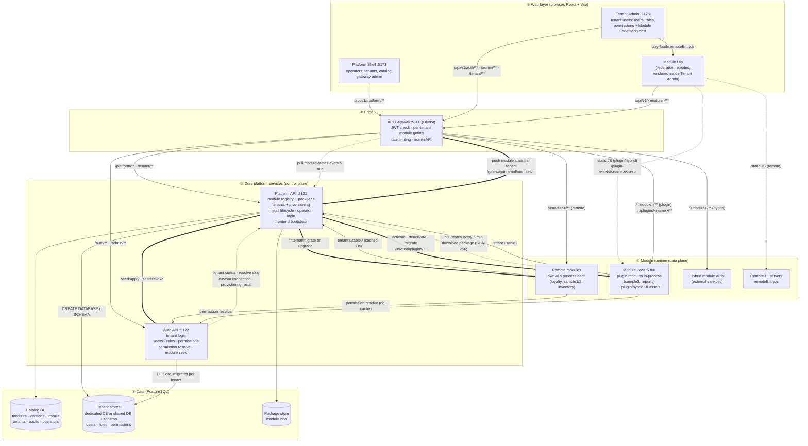
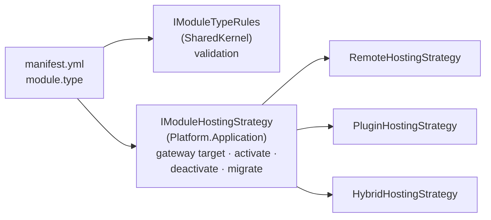
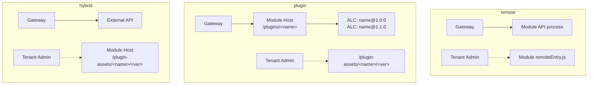
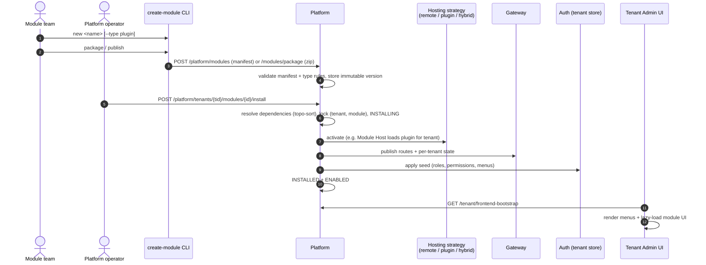
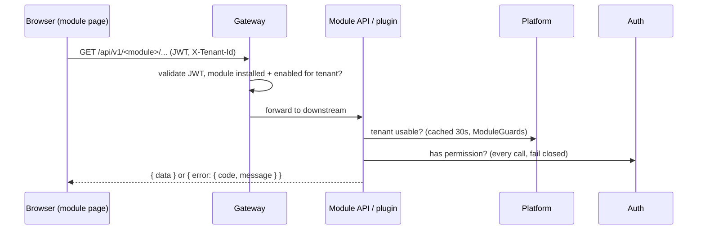

# MSA Module Platform — Module-as-Plugin

A **multi-tenant microservice platform** where business features ship as independently built,
versioned and deployed **modules**. Each module can be installed, enabled, disabled, upgraded or
uninstalled **per tenant** at runtime. You don't need to redeploy the platform or touch other
tenants.

The platform provides the shared infrastructure that every microservice project otherwise has to
build again: API gateway, identity and permissions, tenant provisioning, module registry,
micro-frontend host, plugin runtime, observability and a scaffolding CLI. Teams can then focus on
business modules.

> Implementation lives in [`module_as_plugin/`](module_as_plugin/). This file is the overview.
> For detailed contracts and run options, see
> [`module_as_plugin/README.md`](module_as_plugin/README.md),
> [`SETUP.md`](module_as_plugin/SETUP.md) and the
> [Module Developer Guide](module_as_plugin/docs/module-developer-guide.md).

---

## Contents

1. [What it is](#1-what-it-is)
2. [What it does (functionality)](#2-what-it-does-functionality)
3. [Architecture](#3-architecture)
4. [Supported module types](#4-supported-module-types)
5. [Module lifecycle](#5-module-lifecycle)
6. [Request flow and security](#6-request-flow-and-security)
7. [Repository layout](#7-repository-layout)
8. [Tech stack](#8-tech-stack)
9. [Quick start](#9-quick-start)
10. [Building a new module](#10-building-a-new-module)
11. [How it helps a new microservice project](#11-how-it-helps-a-new-microservice-project)
12. [Further reading](#12-further-reading)

---

## 1. What it is

The platform has two sides:

- **Platform team** runs the core: Gateway, Platform (catalog + tenants + lifecycle), Auth, the
  Module Host, and two portals (Platform shell for operators, Tenant Admin for tenant users).
- **Module teams** build features as modules. A module is a **contract** (`manifest.yml`), an
  **API** (its own service or an in-process plugin), and a **UI** (a Module Federation remote).
  They publish modules to a registry. Platform operators install them for tenants.

The platform reads `manifest.yml` and from it sets up gateway routes, tenant roles and permissions,
menus, UI routes and the hosting runtime. The module team does not write any gateway, auth or
tenant code.

## 2. What it does (functionality)

| Area | Capabilities |
|------|--------------|
| **Module registry / catalog** | Register modules by manifest (JSON) or by **zip package upload**. Versions are immutable and semver-sorted. Covers dependencies, deprecation, "installed in N tenants" and per-tenant install state. |
| **Per-tenant lifecycle** | Install, enable, disable, upgrade, uninstall and retry, with dependency resolution (topo-sort plus semver ranges) and a per-(tenant, module) lock. Changes to one tenant never affect another. |
| **Multi-tenancy** | Tenant create, update, disable and enable with audit trail. Tenant resolution by `domain`, `path` (`/t/{slug}`) or `header`. Data stores are a **dedicated database** or a **shared database with a per-tenant schema**, or a custom connection string kept encrypted with Data Protection. Provisioning runs asynchronously and can be retried. |
| **Identity & authorization** | Separate platform-operator and tenant-user logins (JWT, Argon2id passwords). Tenant users, roles and permissions: effective permissions = role permissions ∪ direct user grants. Last-admin guard. Profile and change-password endpoints. |
| **API Gateway (Ocelot)** | Single entry point (`/api/v1/...`). Routes come from module manifests. Module gating is per tenant: disabled returns `503 MODULE_DISABLED`, not installed returns `404`. Includes an admin API, traffic view, credential rate limiting (`429`) and a reconcile loop with the Platform. |
| **Micro-frontends** | Tenant Admin acts as the Module Federation host. It loads installed module UIs at runtime from `GET /api/v1/tenant/frontend-bootstrap` (routes, menus, permissions) and isolates failures with error boundaries. |
| **Plugin runtime (Module Host)** | Loads plugin modules in-process in a collectible `AssemblyLoadContext` per (module, version). Each tenant has an immutable "shell", so tenants can run **different versions side by side**. Serves plugin UI assets. Verifies package SHA-256. |
| **Developer tooling** | `create-module` CLI: `new`, `list`, `package`, `publish`, `install`, `remove`, `pack`. Includes templates, a generated manifest/seed parity test and a Postman collection. |
| **Operations** | .NET Aspire AppHost (one command starts everything), `docker-compose.yml`, OpenTelemetry, health and readiness endpoints, resilience defaults, and fail-closed secret checks outside Development. |

## 3. Architecture

### 3.1 High-level architecture

Every browser call goes through the **Gateway**. Behind it, the **Platform** is the control plane:
it owns the catalog, tenants and lifecycle, and it pushes desired state to the Gateway, Auth and
the Module Host. **Auth** owns tenant identity and permissions. **Modules** are the data plane for
business features. All communication is HTTP/JSON.



**Legend:** solid arrows (`→`) are request traffic, thick arrows (`⇒`) are control-plane pushes
from the Platform, and dotted arrows (`⇢`) are pulls, reconcile loops or static asset loads.
Internal calls (`/internal/**`, `/gateway/internal/**`) need the `X-Internal-Key` header and the
Gateway never routes them to the outside.

### 3.2 Who talks to whom

| From | To | Call | Purpose |
|------|----|------|---------|
| Platform Shell, Tenant Admin | Gateway | `/api/v1/**` (Vite dev proxy or nginx → `:5100`) | All API traffic uses one entry point |
| Tenant Admin | Module UI server / Module Host | `remoteEntry.js`, `/plugin-assets/<name>/<ver>/` | Loads module pages at runtime (Module Federation) |
| Tenant Admin | Platform (through Gateway) | `GET /api/v1/tenant/frontend-bootstrap` | Gets installed modules, routes and menus for the tenant |
| Gateway | Platform | `/api/v1/platform/**`, `/api/v1/tenant/**` | Operator APIs, catalog, tenants, lifecycle, bootstrap |
| Gateway | Auth | `/api/v1/auth/**`, `/api/v1/admin/**` | Tenant login, profile, user/role/permission admin |
| Gateway | Remote / hybrid module | `/api/v1/<module>/{rest}` → `<artifactApiUrl>/api/v1/{rest}` | Business APIs |
| Gateway | Module Host | `/api/v1/<module>/{rest}` → `/plugins/<module>/api/v1/{rest}` | Plugin business APIs |
| Platform | Gateway | `PUT/DELETE /api/v1/gateway/internal/modules/{m}/tenants/{t}` | Publishes routes and enabled/disabled state per tenant |
| Gateway | Platform | `GET /internal/gateway/module-states` (every 5 min) | Reconciles drift |
| Platform | Auth | `POST /internal/seed:apply`, `/internal/seed:revoke` | Adds or removes module roles, permissions and menus in the tenant store |
| Platform | Module Host | `PUT/DELETE /internal/plugins/{m}/tenants/{t}`, `POST .../versions/{v}/migrate`, `PUT .../versions/{v}/assets` | Activates or deactivates a plugin version for a tenant, migrates it, stages hybrid UI |
| Module Host | Platform | `GET /internal/plugin-host/states` (startup + every 5 min), `GET /internal/modules/{m}/versions/{v}/package` | Reconciles tenant shells and downloads packages (SHA-256 checked) |
| Platform | Remote / hybrid module | `POST <artifactApiUrl>/internal/migrate` | Upgrade data hook |
| Auth | Platform | `GET /internal/tenants/{id}/status`, `/internal/tenants:resolve`, `/internal/tenants/{id}/connection`, `POST /internal/tenants/{id}/<result>` | Checks the tenant is usable, resolves slugs, gets a custom DB connection, reports provisioning results |
| Modules (remote + plugin) | Platform | `GET /internal/tenants/{id}/status` (cached 30 s) | `ModuleGuards.RequireTenantAsync` |
| Modules (remote + plugin) | Auth | `GET /api/v1/auth/permissions/resolve` (every call) | `ModuleGuards.RequirePermissionAsync`, fails closed |
| Platform | PostgreSQL | Catalog DB; `CREATE DATABASE` / `CREATE SCHEMA` | Catalog data, tenant store provisioning |
| Auth | PostgreSQL | Tenant store per tenant (EF Core, lazy migration) | Tenant users, roles and permissions |

### 3.3 Core components

| Component | Path | Port | Responsibility |
|-----------|------|------|----------------|
| **Gateway** | `src/Gateway/Gateway.Api` | 5100 | Ocelot reverse proxy, admin API, per-tenant module state, rate limiting, reconcile from Platform |
| **Platform** | `src/Platform/*` (Domain / Application / Infrastructure / Api) | 5121 | Module registry, package store, operator login, tenant management and provisioning, install lifecycle, hosting strategies, frontend bootstrap |
| **Auth** | `src/Auth/Auth.Api` | 5122 | Tenant login, users/roles/permissions per tenant store, permission resolve, module seed apply/revoke |
| **Module Host** | `src/PluginHost/PluginHost.Api` | 5300 | Loads plugin assemblies (ALC isolation), per-tenant version routing, serves `/plugin-assets/...` |
| **SharedKernel** | `src/Shared/SharedKernel` | — | Manifest models, parser and validator, module-type rules, `ModuleGuards`, error codes, JWT and password helpers |
| **Plugin Abstractions** | `src/Shared/ModulePlatform.Plugin.Abstractions` | — | `IModulePlugin` contract (v1.0) for plugin modules |
| **Platform Shell** | `apps/shell` | 5173 | Operator SPA: tenants, module catalog, gateway admin |
| **Tenant Admin** | `apps/tenant-admin` | 5175 | Tenant SPA: users, roles, permissions. Module Federation host for module UIs |
| **Aspire** | `src/Aspire/*` | dashboard | Local orchestration (AppHost) and shared service defaults (OTel, health, resilience) |

### 3.4 Extensible by design

The lifecycle, catalog and gateway do **not** branch on module type. Each type plugs in through
two small interfaces:



To add a hosting model, implement one `IModuleTypeRules` and one `IModuleHostingStrategy`, then
register them. See
[`ModuleTypes.cs`](module_as_plugin/src/Shared/SharedKernel/ModuleTypes.cs) and
[`ModuleHosting.cs`](module_as_plugin/src/Platform/Platform.Application/ModuleHosting.cs).

## 4. Supported module types

Set with `module.type` in `manifest.yml` (optional, default `remote`).

| | **remote** (default) | **plugin** | **hybrid** |
|---|---|---|---|
| **Backend** | Own .NET API process / container | .NET class library implementing `IModulePlugin`, loaded **in-process** by the Module Host | External API service (optional) |
| **Frontend** | Own Federation remote (`frontend.remoteUrl`) | Package `web/` served by Module Host (`/plugin-assets/<name>/<version>/`) | Package `web/` served by Module Host |
| **Gateway target** | `artifactApiUrl`, else `service.baseUrl` | Module Host `/plugins/<name>/...` | `artifactApiUrl`, else `service.baseUrl` |
| **Registration** | Manifest JSON or zip package | **Zip package only** (`plugin/` + `web/`, SHA-256 verified) | Zip package (for the UI) |
| **Versions per tenant** | One deployment per version | **Side by side** in one host (per-tenant shell) | UI side by side, API as deployed |
| **Isolation** | Process / container | Collectible `AssemblyLoadContext` per (module, version) | Process for API, shared host for UI |
| **Network zones** | `service.network`: `same-cluster` · `cross-cluster` · `public` (https required outside Dev for non-local) | n/a (hosted by platform) | Same as remote |
| **Best for** | Large or independently scaled domains, other languages and runtimes, separate teams | Small or medium features, low ops overhead, fast rollout, many versions | Existing or external APIs that need a UI on the platform without running a web server |
| **Samples** | `loyalty`, `sample1`, `sample2`, `inventory` | `sample3`, `reports` | — |

> `hybrid` is the newest type and is currently being added in the working tree.



## 5. Module lifecycle



Other operations: **disable** (gateway answers `503 MODULE_DISABLED` first, then the backend
refuses), **enable**, **upgrade** (calls the migrate hook on the new version, then activates),
**uninstall** (revokes the seed, removes routes, then deactivates). The Gateway and Module Host
both reconcile from the Platform at startup and every 5 minutes.

## 6. Request flow and security



Built-in guarantees:

- Tenant identity comes from the validated JWT. A mismatched `X-Tenant-Id` returns `403 FORBIDDEN_TENANT`.
- Unknown or disabled tenants return `404 UNKNOWN_TENANT` or `403 TENANT_DISABLED`.
- Permission checks fail closed. If Platform or Auth is unreachable, the response is `503 AUTHZ_UNAVAILABLE`.
- Secrets (`Jwt:SecretKey`, `InternalApi:Key`) are required outside Development, must be at least 32 characters and cannot be the dev default.
- Internal endpoints (`/internal/**`) are protected by `X-Internal-Key` and are not routed by the gateway.
- Package uploads are validated (safe paths, size up to 50 MB, SHA-256). Host-provided assemblies are stripped from plugins.

## 7. Repository layout

```text
MSA/
├── README.md                     # this overview
├── AGENTS.md                     # agent / contributor instructions
├── requirement/                  # source requirements (platform, gateway, tenancy, UI, verification)
├── specs/                        # feature specs (001 sample modules, 002 module hosting types)
└── module_as_plugin/             # implementation
    ├── ModulePlatform.sln
    ├── src/
    │   ├── Gateway/              # Ocelot gateway + admin
    │   ├── Platform/             # Clean Architecture: Domain / Application / Infrastructure / Api
    │   ├── Auth/                 # tenant identity & permissions
    │   ├── PluginHost/           # Module Host (plugin runtime)
    │   ├── Shared/               # SharedKernel + Plugin.Abstractions
    │   ├── Modules/              # sample module backends (remote APIs + plugins)
    │   └── Aspire/               # AppHost + ServiceDefaults
    ├── apps/                     # shell (operators), tenant-admin (tenants, MF host)
    ├── modules/                  # per-module manifest.yml + web (federation remote)
    ├── template/manifest.yml     # full manifest reference
    ├── tools/create-module/      # scaffolding / packaging / publishing CLI
    ├── tests/                    # xUnit: SharedKernel, Platform.Application, PluginHost, Gateway
    ├── docs/                     # developer guide, gap reports, proposals
    ├── postman/                  # API collection
    └── docker-compose.yml
```

## 8. Tech stack

- **Backend:** .NET 8 minimal APIs, EF Core + PostgreSQL 16, Ocelot 25, JWT bearer, Argon2id, ASP.NET Data Protection
- **Frontend:** React 18, Vite 5, `@originjs/vite-plugin-federation`, Tailwind CSS v4, shadcn/ui-style components (Radix)
- **Orchestration and ops:** .NET Aspire 9.5 (AppHost on .NET 9), Docker Compose, OpenTelemetry
- **Testing:** xUnit (manifest validation, module types, packages, plugin loading, tenant shells, lifecycle, gateway state)

## 9. Quick start

Prerequisites: .NET 8 and .NET 9 SDKs, Node.js 20+, Docker.

```bash
cd module_as_plugin

# Everything: Postgres, Gateway, Platform, Auth, Module Host, sample modules, UIs, Aspire dashboard
dotnet run --project src/Aspire/ModulePlatform.AppHost

# Build and test
dotnet build ModulePlatform.sln
dotnet test ModulePlatform.sln
```

| URL | What |
|-----|------|
| http://localhost:5173 | Platform shell (operator login `admin@local`, any password on first Development login) |
| http://localhost:5175 | Tenant Admin (dev seed tenant `tnt_demo`) |
| http://localhost:5100 | Gateway (all API calls) |

For Docker Compose, manual runs and database setup, see [`SETUP.md`](module_as_plugin/SETUP.md).

## 10. Building a new module

```bash
cd module_as_plugin

# Remote module: own API + federation remote, wired into sln, AppHost, compose and tests
node tools/create-module/create-module.mjs new store-ops --display-name "Store Ops" -y

# Plugin module: class library loaded by the Module Host
node tools/create-module/create-module.mjs new reports --type plugin -y
node tools/create-module/create-module.mjs package reports     # dist/modules/reports-1.0.0.zip

# Register and install for a tenant
PLATFORM_PASSWORD=admin node tools/create-module/create-module.mjs publish store-ops
PLATFORM_PASSWORD=admin node tools/create-module/create-module.mjs install store-ops --tenant tnt_demo
```

A generated module includes `/healthz`, `/readyz`, `/internal/seed:preview`, `/internal/migrate`,
an open endpoint and a permission-gated endpoint, a React page, and a parity test that keeps the
manifest and the code in sync. A plugin module implements:

```csharp
public interface IModulePlugin
{
    void ConfigureServices(IServiceCollection services, PluginContext context);
    void MapEndpoints(IEndpointRouteBuilder endpoints, PluginContext context);
    Task MigrateAsync(PluginMigration migration, IServiceProvider services, CancellationToken ct); // optional
}
```

The full walkthrough covers the manifest reference, validation rules, adding endpoints,
permissions and pages, versioning and the verification checklist. See the
[Module Developer Guide](module_as_plugin/docs/module-developer-guide.md).

## 11. How it helps a new microservice project

| Typical microservice problem | What the platform gives you |
|------------------------------|-----------------------------|
| Every service builds its own auth, tenant checks and permission model | Shared Auth service plus `ModuleGuards`: two calls secure an endpoint, fail closed |
| Gateway config drifts from the services | Gateway routes are generated from each module's `manifest.yml` and reconciled automatically |
| Monolithic frontend couples all teams | Module Federation: each module ships its own UI, loaded at runtime per tenant |
| Too many small services to run and pay for | `plugin` type: many small modules share one Module Host with in-process isolation |
| Turning a feature on for some customers only | Per-tenant install, enable and disable, with no redeploy and no effect on other tenants |
| Rolling out new versions safely | Immutable versions, per-tenant upgrade with migrate hook, side-by-side plugin versions |
| Inter-module dependencies | Semver ranges, topo-sorted install, cycle and conflict detection |
| Tenant data isolation | Dedicated database, shared database with per-tenant schema, or custom encrypted connection |
| Slow team onboarding | `create-module new` scaffolds a working, tested, wired module in one command |
| Local environment setup | One `dotnet run` (Aspire) brings up the whole stack with telemetry |

**Suggested adoption path for a new project:**

1. Run the platform as is and keep the core services (Gateway, Platform, Auth, Module Host, portals) unchanged.
2. Model each bounded context as a module. Start with `plugin` for small features and use
   `remote` for domains that need independent scaling, a separate runtime or a separate team.
   Use `hybrid` to put a UI in front of an existing external API.
3. Scaffold with `create-module`, define permissions and menus in `manifest.yml`, and implement
   the business logic.
4. Publish to the registry and install for pilot tenants first, then roll out by tenant.
5. Iterate with immutable versions and per-tenant upgrades.

## 12. Further reading

| Document | Content |
|----------|---------|
| [`module_as_plugin/README.md`](module_as_plugin/README.md) | Detailed contracts: tenants, login, catalog, routing, provisioning, secrets |
| [`module_as_plugin/SETUP.md`](module_as_plugin/SETUP.md) | Local setup (Aspire, Docker, manual) |
| [`module_as_plugin/docs/module-developer-guide.md`](module_as_plugin/docs/module-developer-guide.md) | End-to-end module development guide |
| [`module_as_plugin/tools/create-module/README.md`](module_as_plugin/tools/create-module/README.md) | CLI reference |
| [`module_as_plugin/template/manifest.yml`](module_as_plugin/template/manifest.yml) | Full manifest example |
| [`module_as_plugin/docs/gap-closure-report.md`](module_as_plugin/docs/gap-closure-report.md) | Closed gaps (per-tenant gateway state, etc.) |
| [`requirement/`](requirement/) | Original requirements and guidelines |
| [`specs/`](specs/) | Feature specs, plans, tasks and contracts |
