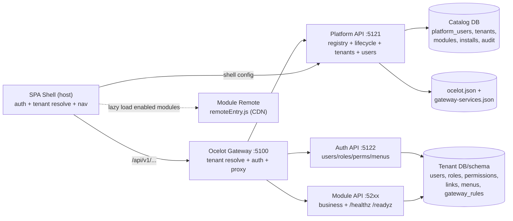
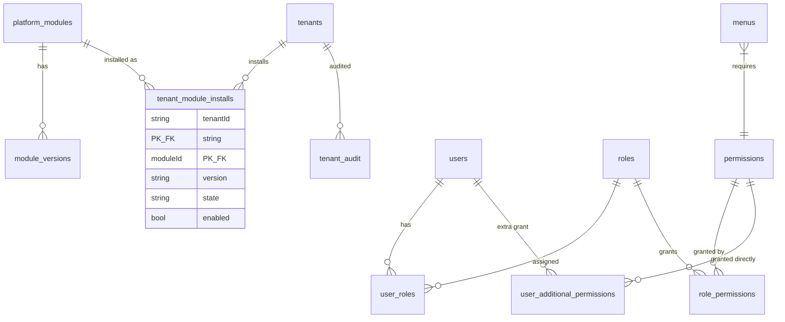

# Module-as-Plugin Platform — Requirement & System Design

> Audience: Product Manager → Senior Architect → Senior Developer.
> Stack (baseline, greenfield): Backend .NET Core (.NET 8+) API, Ocelot Gateway, PostgreSQL; Frontend ReactJS (React 18 + Vite + Module Federation micro-frontend), Single Page Application, multi-tenant.
> Status: Confirmed Requirement unless marked Assumption / Recommendation / Open Question.
> Location: `module_as_plugin/` (new greenfield application; no dependency on any existing codebase).

---

# PHASE 1 — PRODUCT REQUIREMENT

## 1. Business Problem

We need to ship business modules (Loyalty, Orders, Rewards, Campaigns, future modules) as independent plugins on one multi-tenant SaaS platform without redeploying the platform:

- Today adding a module means code changes to the monolith, manual gateway edits, manual role/menu seeding per tenant, and a full redeploy.
- Tenants cannot browse, trial, enable, or remove modules self-containedly; every tenant gets the same bundle.
- Frontend is a single bundle — adding a module's UI requires rebuilding the shell.
- There is no standard contract for what a module provides (APIs, routes, menus, permissions, dependencies, health).

## 2. Business Justification

- **Speed:** new module goes live by publishing a `manifest.yml` + deploying its own service, then tenants install in 1 click. No platform redeploy.
- **Isolation:** one module's failure/version does not take down the platform or other modules (own service, own DB/schema, gateway-routed).
- **Tenant choice:** tenants install only what they need; enable/disable/uninstall without data loss surprises.
- **Governance:** platform controls what is installable (registry, versions, dependencies) and audits every lifecycle action.
- Who benefits: platform ops (1 deployment serves many tenants), module teams (independent release), tenant admins (self-service catalog), end users (single SPA shell with unified nav/auth).

## 3. Scope

### In scope (v1)

1. **Platform service (API + frontend shell):** platform users, basic roles (`Admin`, `Maintainer`), tenant CRUD, gateway configuration UI/API, module/plugin registry + tenant install catalog page.
2. **Gateway service (Ocelot):** single entry point; v1 ships with 2 baseline downstream services (`platform`, `auth`); all module APIs registered as Ocelot routes (hot-apply, no restart).
3. **Auth service (API + frontend):** tenant user management, role & permission management (`role permission` + `user additional permission`). Platform users live in Platform service, not Auth.
4. **Module template (standard):** every module ships API + frontend remote + `manifest.yml`; supports `install / uninstall / enable / disable / upgrade`.
5. **Multi-tenancy:** per-tenant install state; per-tenant DB seeding (`users, roles, permissions, menus, user-role, role-permission, user-additional-permission, api-gateway rules`); dependency enforcement; per-tenant enable/disable.
6. **`manifest.yml` contract:** normative schema + example + validation rules.

### Out of scope (v1)

- Self-service tenant signup, billing/metering per module, per-tenant custom code, cross-tenant data sharing, multi-region pinning.
- Automatic DB migration of module data on upgrade beyond additive EF migrations + explicit `upgradeNotes`.
- Visual page-builder / runtime plugin sandboxing (modules are trusted first-party services).
- Gateway advanced features UI (QoS, rate-limit, caching editors) — supported by Ocelot JSON passthrough only.

## 3B. Technology Selection and Justification (Confirmed Baseline)

Greenfield baseline: **Frontend ReactJS, Backend .NET Core.** No dependency on any existing codebase.

| Layer | Selected | Justification (requirement-fit) | Rejected alternative |
|---|---|---|---|
| Frontend framework | ReactJS 18 + TypeScript (SPA) | Component/route/menu composition maps 1:1 to `manifest.yml:frontend` and bootstrap payload (§10.4); error boundaries isolate a failed remote; single TS skillset for shell + remotes; large ecosystem (routing, server-state cache, forms, i18n, testing). | Angular/Vue: splits shell/remote skillset, no plugin benefit. SSR frameworks (Next/Remix): no SEO need, adds server ops. |
| Build / dev | Vite 5 | Fast dev/build, ESM-native code-splitting per route, compatible with Federation remote output (`remoteEntry.js`). | CRA/webpack-only: slower, heavier per-module builds. |
| Micro-frontend | Module Federation (host + remotes) | Shell (host) lazy-loads `scope/remoteUrl` from `GET /tenant/frontend-bootstrap` only when installed+enabled; version-pinned URLs; `shared react/react-dom` singletons; no shell rebuild on install/enable/disable. | single-spa/iframe: heavier runtime or weak UI integration; direct `manifest.yml` fetch by browser: forbidden (R10, secrets + seed leak). |
| Backend runtime | .NET Core (.NET 8+, ASP.NET Core) | One runtime for gateway/platform/auth/modules: shared JWT validation, shared middleware order (tenant resolve → status → auth → module-enabled guard), DI, background workers for install/upgrade jobs, `/healthz`/`/readyz`, single-binary containers. | Node/Java split: no contract advantage, splits gateway stack. |
| Gateway | Ocelot (file JSON + hot-swap) | Manifest `apiRoutes[]` generate Ocelot routes (`/api/v1/{moduleId}/{rest}`); validate → persist → hot-swap with no restart; admin API + traffic snapshot in same process. | Kong/Nginx: separate ops skill + custom auth glue. |
| Data access | EF Core (migrations per tenant) | Provisioning runs migration set per tenant DB/schema; additive module upgrades; per-request `DbContext` factory gives DB/schema isolation without `tenantId` columns. | Raw SQL/Dapper-only: loses migration runner for install/upgrade pipeline. |
| Database | PostgreSQL (dedicated DB default, shared-DB schema fallback) | Transactional DDL for all-or-nothing seed; unique indexes for `code/name/menus.id`; JSONB for audit diff; per-schema migration history. | Mongo/MySQL: weaker schema + transactional DDL for install rollback. |
| Auth | JWT Bearer + OIDC RP-only (maintained libs), Argon2 fallback | Tenant JWT (`tenantId`) vs platform JWT (`Admin/Maintainer`); RP-only flow, no custom crypto; resolve endpoint + short-TTL cache; fail closed. | Self-built tokens/IdP: protocol risk, out of scope. |

## 4. Actors & Roles

| Actor | Scope | Can | Cannot |
|---|---|---|---|
| **Platform Admin** (`PLATFORM_ADMIN`) | Global | Everything: manage platform users, roles, tenants, gateway, module registry (publish/deprecate), install/uninstall any module on any tenant, force enable/disable | Access tenant business data except via audited support view (v1: no direct access) |
| **Platform Maintainer** (`PLATFORM_MAINTAINER`) | Global, restricted | View tenants (read-only list/details); **full manage gateway** (services, routes, reload, traffic); view module registry & install states; no tenant create/disable, no module publish, no platform user admin | Create/disable tenants; publish modules; manage platform users |
| **Tenant Admin** (`TENANT_ADMIN`, lives in Auth) | Exactly one tenant | Browse module catalog, install/uninstall/enable/disable allowed modules for own tenant; manage tenant users/roles/menus | Install modules with unmet dependencies; touch other tenants; manage gateway; publish modules |
| **Module Developer** | Module repo | Author `manifest.yml`, implement template health/seed endpoints, publish version to registry | Bypass platform validation; write directly to tenant DBs |
| End customer / POS | Tenant-scoped | Use installed module features via gateway | Reach install/admin surfaces |

**Authorization rule (all surfaces):** every action is role-checked server-side. UI hiding is UX only.

## 5. Business Requirements

### 5.1 Platform service

| ID | Requirement |
|---|---|
| P-BR1 | Platform manages **platform users** (ops accounts): create, list, deactivate/reactivate, reset password. Distinct from tenant users (Auth owns tenant users). |
| P-BR2 | Platform ships exactly **2 basic roles** in v1: `Admin` (all permissions) and `Maintainer` (tenant-read + gateway-full). No custom platform roles in v1. |
| P-BR3 | Platform manages **tenants**: CRUD + enable/disable, resolution (domain / path `/t/{slug}` / `X-Tenant-Id`), provisioning state (dedicated DB or shared-DB schema). |
| P-BR4 | Platform manages **gateway configuration**: services list, routes list, create/edit/delete, validate-before-apply, hot-apply (no restart), traffic view. |
| P-BR5 | Platform hosts the **module catalog page** (tenant-scoped view + global registry view): browse available modules (name, description, version, owner, dependencies, status), filter by installed/enabled/available, **Install** button per module. |
| P-BR6 | Install is **dependency-first**: system resolves `dependencies[]`, installs missing dependencies beforehand in topological order; if any dependency cannot be installed, the whole install is rejected with the blocking chain. |
| P-BR7 | On install, platform writes the module's seed into the **tenant DB**: `users (seed accounts, if any), roles, permissions, menus, user-role, role-permission, user-additional-permission, api-gateway rules`. All-or-nothing per module (transactional). |
| P-BR8 | After install, tenant can **enable, disable, uninstall** the module from the same catalog page. Disable keeps data + routes (gateway returns `503 MODULE_DISABLED`); uninstall removes routes/menus/permissions (data archived per retention rule, never silently dropped). |
| P-BR9 | Platform **registers module APIs to the gateway** on install/enable (add Ocelot routes from manifest) and deregisters/disables on disable/uninstall. Hot-applied. |
| P-BR10 | Platform stores **module registration**: service detail (name, baseUrl, health endpoint, version) + frontend detail (remote URL, scope, exposed routes/menus) from `manifest.yml`. |
| P-BR11 | Every platform action is audited (actor, tenant, module, version, action, result). |

### 5.2 Gateway service

| ID | Requirement |
|---|---|
| G-BR1 | Gateway is Ocelot 25, single entry point for all SPA + API traffic. |
| G-BR2 | V1 ships with **2 baseline downstream services**: `platform` (platform API) and `auth` (auth API). No tenant traffic works without them. |
| G-BR3 | Every module API is exposed **only through the gateway** (no direct service calls from browser). Route shape: `/api/v1/{moduleId}/{rest}` → module downstream. |
| G-BR4 | Gateway admin API (`/api/v1/gateway/**`) supports service/route CRUD + hot reload + traffic snapshot. |
| G-BR5 | Disabled module → gateway short-circuits with `503 MODULE_DISABLED` without proxying. Uninstalled module → `404 UNKNOWN_MODULE_ROUTE`. |

### 5.3 Auth service

| ID | Requirement |
|---|---|
| A-BR1 | Auth manages **tenant users** (per-tenant store: tenant DB or schema; platform users stay in Platform service). CRUD + activate/deactivate; deactivation blocks login + APIs + revokes sessions. |
| A-BR2 | Auth manages **roles**: create/update/deactivate/reactivate; system seed roles per module + custom tenant roles. |
| A-BR3 | Permission model = **`role permission` UNION `user additional permission`**, deduplicated. Deny by default. Only `ACTIVE` users/roles contribute. |
| A-BR4 | Auth owns tables (per tenant store): `users, roles, permissions, user_roles, role_permissions, user_additional_permissions, menus (or menu-permission link), admin_sessions`. No `tenantId` discriminator inside tenant store — isolation by DB/schema. |
| A-BR5 | Auth exposes resolve endpoint for gateway/Core: `GET /api/v1/auth/permissions/resolve?tenantId&userId` → effective set + version (cached, TTL 60s proposed). |
| A-BR6 | Auth ships a small frontend (micro-frontend remote): Users page, Roles page, Permissions (read-only catalog) page, embedded in the shell. |

### 5.4 Module service (template)

| ID | Requirement |
|---|---|
| M-BR1 | Every module is built from the **standard template**: .NET API + React remote + `manifest.yml` at repo root. No ad-hoc layout. |
| M-BR2 | Module declares **metadata**: `name, displayName, description, version (semver), owner (team/email), license, icon, category`. |
| M-BR3 | Module declares **dependencies**: `[{ name, versionRange }]`; empty = standalone. |
| M-BR4 | Module declares **frontend**: remote entry (`remoteUrl, scope, modulePrefix`), `routes[]` (path, exposed module, required permission, menu link), `menus[]` (id, parent, title, icon, route, required permission, order), `uiPermissions[]`. |
| M-BR5 | Module declares **API**: `service { baseUrl placeholder, healthCheck, openapiUrl }`, `apiRoutes[]` (upstream template, downstream template, methods, auth/permission, rate-limit hint), `seed { roles[], permissions[], menus[], userRoles[], rolePermissions[], userAdditionalPermissions[], gatewayRules[] }`. |
| M-BR6 | Module lifecycle supported by platform: `install → enable ⇄ disable → uninstall`, plus `upgrade (version bump)`. Each is an explicit API + UI action with guards. |
| M-BR7 | Module API implements `GET /healthz` (liveness) and `GET /readyz` (readiness incl. DB check); platform/gateway health-gates routing on these. |
| M-BR8 | Module never writes to another module's tables or to platform/auth stores directly; cross-module calls go through gateway with tenant JWT. |

## 6. System Requirements

| ID | Requirement |
|---|---|
| SR-1 | Microservices: `gateway (:5100)`, `platform (:5121)`, `auth (:5122)`, `module-{id} (:52xx, one per module)`. Each has its own deployment + health endpoints. |
| SR-2 | SPA shell (`apps/shell`): ReactJS + Vite + Module Federation host; auth guard, tenant resolver, dynamic nav from platform-provided **frontend bootstrap** (not `manifest.yml`), remote loader with error boundary + version pin. Shell never fetches `manifest.yml` directly. |
| SR-3 | Each module frontend is a Module Federation **remote** (`remoteEntry.js`, unique `scope`), exposing `./routes` (route table) and `./menus` (menu contribution). Shell lazy-loads remotes only for enabled modules using the bootstrap payload. |
| SR-4 | Tenant resolution order (deterministic): `X-Tenant-Id` header/route → `Host` domain match → `/t/{slug}` path prefix → unresolved `404 UNKNOWN_TENANT`. Disabled tenant → `403 TENANT_DISABLED` before any module logic. |
| SR-5 | Install pipeline (server-side, idempotent, per-tenant lock): `validate manifest → check registry → resolve dependencies (topo-sort, install missing first) → create tenant-install row (INSTALLING) → apply gateway routes → seed tenant DB (roles/permissions/menus/links/gateway-rule refs) → register service+frontend details → mark INSTALLED+ENABLED → audit`. Any step failure → `FAILED` + rollback of that module's partial writes + actionable error. |
| SR-6 | `manifest.yml` is platform-only (module registry). Stored in `module_versions.manifestYaml`, validated on publish, never served to the browser. Frontend Vite needs are served via a derived minimal payload (SR-6b). |
| SR-6b | Platform exposes tenant-scoped `GET /api/v1/tenant/frontend-bootstrap` returning **only Vite-required fields** for installed+enabled modules: `[{ moduleId, version, scope, remoteUrl, modulePrefix, routes[{path, exposes, requiredPermission, menuId}], menus[{id, parentId, title, icon, route, requiredPermission, order}], uiPermissions[] }]`. No seed, no apiRoutes, no dependencies, no secrets. Shell uses this to register Federation remotes + build nav. |
| SR-7 | Gateway routes generated from manifest `apiRoutes[]` + tenant context: upstream `/api/v1/{moduleId}/{rest}`. Authenticated routes require tenant JWT; permission enforced by module API via Auth resolve (cached). |
| SR-8 | Module registry stores immutable versions (`moduleId + version` unique); `upgrade` = install newer version's diff (new permissions/menus/routes added, removed ones flagged; data migrations run via module's own `POST /internal/migrate` hook, additive only in v1). |
| SR-9 | API conventions: `/api/v1/...` prefix, `{data}` / `{error:{code,message,details}}` envelope, CUID ids, UTC timestamps, JWT in memory (never localStorage token). |

## 7. Business Rules

- R1. Platform `Admin` can do anything; `Maintainer` = tenant read-only + gateway full manage (services/routes/reload/traffic) + module install-state read-only. Any other combination → `403 FORBIDDEN`.
- R2. Dependencies must be **installed and enabled** before the dependent module installs; uninstall of a module required by another installed module is rejected (`409 DEPENDENCY_IN_USE` listing dependents) unless dependents are uninstalled first.
- R3. Version ranges use semver (`^1.2.0`, `>=2.0.0 <3.0.0`); install picks the latest registry version satisfying all dependents' ranges; conflict → reject with explanation.
- R4. Permission `code` format `^[A-Z]+_[A-Z_]+$` (`OBJECT_ACTION`), unique per tenant store, immutable once seeded. Role `name` unique case-insensitive per tenant store.
- R5. Menu `id` unique per tenant; `parentId` must exist or be null (top-level); disabled/uninstalled module's menus hidden immediately (no shell reload required beyond nav refresh).
- R6. Disable keeps data and permissions; blocks API (gateway `503`) and hides menus/routes. Uninstall removes gateway routes + menu contributions + permission grants from roles/users created by that module's seed; tenant-created custom roles keep unknown codes as inert history (never auto-deleted).
- R7. `enable` requires dependencies enabled + health passing + gateway rules applicable; otherwise `422 MODULE_NOT_READY`.
- R8. One install job per (tenant, module) at a time (distributed lock); re-install of same version is idempotent success.
- R9. Platform users and tenant users are disjoint stores; a platform JWT never authorizes tenant module APIs and vice versa (`FORBIDDEN_TENANT` on mismatch).
- R10. `manifest.yml` is platform-only. Shell/remotes must consume `GET /tenant/frontend-bootstrap` only; direct manifest fetch (registry, module `/manifest`, or CDN YAML) is forbidden and rejected with `403 FORBIDDEN` if attempted via platform routes.

## 8. Workflow

### 8.1 Publish a module version (developer → registry)

1. Developer scaffolds from template, edits `manifest.yml`, implements API + remote.
2. `POST /api/v1/platform/modules` with manifest + artifact refs → platform validates → stores immutable version → status `AVAILABLE`.
3. Module appears in catalog browse page for all tenants (subject to dependency visibility).

### 8.2 Browse & install (tenant admin)

1. Tenant admin opens **Modules / Catalog** (`/modules` in shell): cards with name, description, version, owner, dependencies, `Installed / Enabled / Available` badge.
2. Click **Install** → platform resolves dependencies, shows plan ("will also install X v1.3.0") → confirm.
3. Platform runs SR-5 pipeline; UI polls `GET /tenant/modules/{moduleId}` until `INSTALLED`.
4. New menus appear in shell nav; new API routes live on gateway. No shell redeploy.

### 8.3 Enable / Disable / Uninstall / Upgrade

- **Disable:** `POST /tenant/modules/{id}/disable` → gateway marks routes disabled → shell hides menus/routes → APIs `503 MODULE_DISABLED`. Data retained.
- **Enable:** `POST .../enable` → health check + dependency check → gateway re-enables → menus return.
- **Uninstall:** `POST .../uninstall` (confirm, list dependents) → gateway routes removed → seed grants revoked per R6 → state `NOT_INSTALLED` (history retained in audit).
- **Upgrade:** `POST .../upgrade {toVersion}` → dependency re-resolve → run module migrate hook → seed diff applied → gateway routes updated → state `INSTALLED` at new version.

## 9. API & Integration

Base: gateway-origin `/api/v1/...` (browser never calls module ports directly).

### 9.1 Platform — registry & lifecycle (Platform Admin; Maintainer read-only except gateway)

```http
GET    /api/v1/platform/modules                       list registry (id, latest version, owner, status)
POST   /api/v1/platform/modules                       publish version { manifestYaml|manifest, artifactRefs } → 201
GET    /api/v1/platform/modules/{id}                  registry detail + versions[]
POST   /api/v1/platform/modules/{id}/deprecate        hide from catalog (existing installs unaffected)
GET    /api/v1/platform/tenants/{tid}/modules         per-tenant install states
POST   /api/v1/platform/tenants/{tid}/modules/{id}/install {version?}
POST   /api/v1/platform/tenants/{tid}/modules/{id}/enable
POST   /api/v1/platform/tenants/{tid}/modules/{id}/disable   {reason}
POST   /api/v1/platform/tenants/{tid}/modules/{id}/uninstall {confirmDependents}
POST   /api/v1/platform/tenants/{tid}/modules/{id}/upgrade   {toVersion}
GET    /api/v1/platform/tenants                       tenant CRUD (existing semantics)
```

### 9.2 Tenant self-service catalog (Tenant Admin)

```http
GET    /api/v1/tenant/modules                         browse (module, latestVersion, installState, dependencies)
GET    /api/v1/tenant/modules/{id}                    detail + install plan preview
POST   /api/v1/tenant/modules/{id}/install
POST   /api/v1/tenant/modules/{id}/enable
POST   /api/v1/tenant/modules/{id}/disable
POST   /api/v1/tenant/modules/{id}/uninstall
POST   /api/v1/tenant/modules/{id}/upgrade
GET    /api/v1/tenant/frontend-bootstrap              Vite-only payload (SR-6b): enabled modules' scope/remoteUrl/routes/menus/uiPermissions
```

### 9.3 Gateway admin (Admin full; Maintainer full; Tenant none)

```http
GET    /api/v1/gateway/summary
GET    /api/v1/gateway/services            POST /api/v1/gateway/services
PUT    /api/v1/gateway/services/{id}       DELETE /api/v1/gateway/services/{id}
GET    /api/v1/gateway/routes              POST /api/v1/gateway/routes
PUT    /api/v1/gateway/routes/{id}         DELETE /api/v1/gateway/routes/{id}
POST   /api/v1/gateway/config/reload
GET    /api/v1/gateway/traffic
```

Module install/uninstall writes routes here internally (same store, `source=module-install`, audited).

### 9.4 Auth (tenant scope)

```http
GET    /api/v1/auth/permissions
GET    /api/v1/auth/permissions/resolve?tenantId&userId
GET    /api/v1/admin/users  POST /api/v1/admin/users  PUT /api/v1/admin/users/{id}
POST   /api/v1/admin/users/{id}/deactivate  POST /api/v1/admin/users/{id}/activate
GET    /api/v1/admin/roles  POST /api/v1/admin/roles  PUT /api/v1/admin/roles/{id}
POST   /api/v1/admin/roles/{id}/deactivate   POST /api/v1/admin/roles/{id}/activate
GET    /api/v1/admin/users/{id}/roles        POST/DELETE .../roles/{roleId}
GET    /api/v1/admin/users/{id}/permissions  POST/DELETE .../permissions/{code}
GET    /api/v1/admin/roles/{id}/permissions  POST/DELETE .../permissions/{code}
```

### 9.5 Module template API (every module implements)

```http
GET    /healthz            liveness {status: ok, module, version}
GET    /readyz             readiness {ready, checks:{db, dependencies}}
POST   /internal/seed:preview   {tenantId} → dry-run seed diff (roles/permissions/menus/routes)
POST   /internal/migrate       {fromVersion,toVersion} → additive migrations only
```

No `GET /manifest` on modules: full manifest never leaves the platform registry (R10).

Error envelope: `{ "error": { "code", "message", "details": {...} } }`.
Codes: `UNKNOWN_TENANT, TENANT_DISABLED, UNKNOWN_MODULE, MODULE_ALREADY_INSTALLED, MODULE_NOT_INSTALLED, MODULE_DISABLED, DEPENDENCY_MISSING, DEPENDENCY_IN_USE, VERSION_CONFLICT, VALIDATION_ERROR, IMMUTABLE_FIELD, FORBIDDEN, FORBIDDEN_TENANT, UNAUTHORIZED, PROVISION_FAILED, GATEWAY_APPLY_FAILED`.

## 10. Data Requirements

### 10.1 Platform store (catalog DB)

```text
platform_users(id PK cuid, email UK CI, name, passwordHash Argon2, role Admin|Maintainer, isActive, lastLoginAt, createdAt, updatedAt)
tenants(id PK, name UK CI, slug UK, status, resolutionMode, domain UK NULL, pathPrefix UK NULL, dbName, schema, dbStatus, dbError NULL, schemaVersion NULL, contactEmail, createdAt, updatedAt)
platform_modules(id PK slug e.g. loyalty, displayName, description, owner, icon, category, status AVAILABLE|DEPRECATED, createdAt, updatedAt)
module_versions(id PK cuid, moduleId FK, version semver, manifestYaml TEXT, manifestHash, artifactApiUrl, artifactRemoteUrl, status, publishedBy, publishedAt; UNIQUE(moduleId, version))
tenant_module_installs(tenantId FK, moduleId, version, state NOT_INSTALLED|INSTALLING|INSTALLED|DISABLED|FAILED|UNINSTALLING, enabled bool, installedAt, updatedAt, error NULL; PK(tenantId, moduleId))
tenant_audit(id PK, tenantId NULL, actorId, actorRole, action, resourceType, resourceId, diff JSONB NULL, reason NULL, createdAt)
gateway_services + gateway_routes (file-backed registry in gateway service; module rows tagged source=module-install, managedBy=platform)
```

### 10.2 Tenant store (per tenant DB/schema — written on module install)

Seeded/updated by each module's manifest `seed` section, namespaced by module to avoid collisions (`code` prefix recommended: `LOYALTY_MEMBER_VIEW` or at least unique):

```text
users(id PK cuid, email UK CI, name, passwordHash NULL for seeded service accounts, isActive, createdAt, updatedAt)
roles(id PK cuid, name UK CI, description, moduleId NULL(system seed link), isSystem bool, isActive, createdAt, updatedAt)
permissions(id PK cuid, code UK e.g. ORDER_VIEW, object, action, name, moduleId, isMenuAccess bool, createdAt)
user_roles(userId FK, roleId FK; PK(userId,roleId))
role_permissions(roleId FK, permissionId FK; PK(roleId,permissionId))
user_additional_permissions(userId FK, permissionId FK; PK(userId,permissionId))
menus(id PK slug e.g. loyalty.members, parentId NULL FK, title, icon NULL, route NULL, moduleId, requiredPermission NULL FK permissions.code, sortOrder int, isActive; UNIQUE(id))
gateway_rules(id PK cuid, moduleId, upstreamTemplate, downstreamTemplate, methods JSONB, permission NULL, enabled bool, appliedAt NULL)
  -- logical record of what was applied to Ocelot; physical routes live in gateway store
```

### 10.3 `manifest.yml` — normative schema (platform-only registry contract)

Location: module repo root `manifest.yml` → stored as `module_versions.manifestYaml` on publish. Validated on publish; invalid → `400 VALIDATION_ERROR`. Never served to the browser; Vite shell uses `GET /tenant/frontend-bootstrap` (SR-6b) instead.

```yaml
# manifest.yml — Module registration contract (v1). All keys required unless marked optional.
manifestVersion: "1.0"          # contract version (this schema), semver string

module:
  name: loyalty                 # slug, ^[a-z0-9-]{3,50}$, immutable, URL prefix /api/v1/{name}
  displayName: Loyalty Program   # 3-100 chars
  description: Points, tiers and rewards for tenant members.
  version: 1.4.0                # semver of THIS publish; immutable per publish
  owner: loyalty-team@company.com
  license: proprietary         # optional
  icon: loyalty                # optional, icon key for shell nav
  category: engagement         # optional: engagement|sales|ops|analytics

dependencies:                   # optional, default []
  - name: auth                  # must exist in registry (auth/platform are implicit base, not listed)
    versionRange: ">=1.0.0 <2.0.0"
  - name: members
    versionRange: "^2.1.0"

service:
  healthCheck: /healthz         # GET, 200 {status: ok}
  readinessCheck: /readyz       # GET, 200 {ready: bool}
  openapiUrl: /swagger/v1/swagger.json   # optional
  minPlatformVersion: ">=1.0.0" # optional, platform compat gate

frontend:
  remoteUrl: https://cdn.example.com/loyalty/1.4.0/remoteEntry.js  # prod URL template; per-env override allowed
  scope: loyalty_remote         # Module Federation scope, unique globally
  modulePrefix: /loyalty        # shell mount point; all routes below must start with this
  routes:                       # at least one if frontend exists
    - path: /loyalty/members
      exposes: ./MembersPage    # remote expose key
      requiredPermission: LOYALTY_MEMBER_VIEW  # optional; null = authenticated only
      menuId: loyalty.members   # optional link to menus[] below
  menus:
    - id: loyalty               # unique per tenant; top-level when parentId null
      parentId: null
      title: Loyalty
      icon: star                # optional
      route: /loyalty           # optional for group headers
      requiredPermission: null  # group may be permission-free; children enforce
      order: 20
    - id: loyalty.members
      parentId: loyalty
      title: Members
      icon: users
      route: /loyalty/members
      requiredPermission: LOYALTY_MEMBER_VIEW
      order: 1
  uiPermissions: [LOYALTY_MEMBER_VIEW, LOYALTY_MEMBER_UPDATE]  # subset of seed.permissions[].code, used for button gating

api:
  routes:                       # each becomes one Ocelot route (upstream → downstream)
    - upstream: /api/v1/loyalty/members/{rest}
      downstream: /api/v1/members/{rest}
      methods: [GET, POST]      # empty = all methods
      auth: true                # false only for /healthz-style public probes (discouraged)
      requiredPermission: LOYALTY_MEMBER_VIEW  # optional; enforced by module API
      priority: 10              # 0..999, higher wins
  seed:
    roles:
      - name: Loyalty Operator
        description: Runs loyalty day-to-day
        isSystem: true
    permissions:
      - code: LOYALTY_MEMBER_VIEW
        object: LOYALTY_MEMBER
        action: VIEW
        name: View loyalty members
        isMenuAccess: true
      - code: LOYALTY_MEMBER_UPDATE
        object: LOYALTY_MEMBER
        action: UPDATE
        name: Update loyalty members
        isMenuAccess: false
    menus: []                   # optional inline alternative to frontend.menus (frontend.menus wins if both set; validator warns on conflict)
    userRoles:                  # predefined assignments for seed users/roles
      - userEmail: ops@example.com
        roleName: Loyalty Operator
    rolePermissions:
      - roleName: Loyalty Operator
        permissions: [LOYALTY_MEMBER_VIEW, LOYALTY_MEMBER_UPDATE]
    userAdditionalPermissions:  # user-level grants outside roles
      - userEmail: auditor@example.com
        permissions: [LOYALTY_MEMBER_VIEW]
    users:                      # optional seed accounts (bootstrap only; password must rotate)
      - email: ops@example.com
        name: Loyalty Operator
    gatewayRules: []            # optional; defaults to api.routes above. Explicit entries override.

upgrade:
  notes: "1.4.0 adds LOYALTY_TIER_UPDATE; no data migration."  # optional, shown on upgrade confirm
  migrateEndpoint: /internal/migrate  # optional; called with {fromVersion,toVersion} on upgrade
```

Validation rules (platform enforces): `module.name` slug + reserved list (`admin, api, platform, auth, gateway, t, health, metrics, docs, login, static`); `version` valid semver; `dependencies[].versionRange` valid semver range; no self-dependency; no duplicate `permissions[].code` / `menus[].id` / `api.routes[].upstream` within the file; every `requiredPermission` referenced by routes/menus/uiPermissions exists in `seed.permissions[]`; `frontend.routes[].path` starts with `modulePrefix`; `scope` globally unique across registry; `remoteUrl` absolute https (http allowed only in Development).

### 10.4 Frontend bootstrap (Vite-only, derived from manifest)

`GET /api/v1/tenant/frontend-bootstrap` → platform filters to installed+enabled modules for the resolved tenant and returns only:

```json
{ "data": { "tenantId": "tnt_abc", "modules": [
  { "moduleId": "loyalty", "version": "1.4.0",
    "scope": "loyalty_remote",
    "remoteUrl": "https://cdn.example.com/loyalty/1.4.0/remoteEntry.js",
    "modulePrefix": "/loyalty",
    "routes": [{ "path": "/loyalty/members", "exposes": "./MembersPage",
                  "requiredPermission": "LOYALTY_MEMBER_VIEW", "menuId": "loyalty.members" }],
    "menus": [{ "id": "loyalty.members", "parentId": "loyalty", "title": "Members",
                "route": "/loyalty/members", "requiredPermission": "LOYALTY_MEMBER_VIEW", "order": 1 }],
    "uiPermissions": ["LOYALTY_MEMBER_VIEW"] }
]}}
```

Rules: tenant JWT required; disabled/uninstalled modules excluded; `remoteUrl` per-env resolved by platform; cacheable 30s, invalidated on enable/disable/install/uninstall/upgrade.

### 10.5 Module template layout (standard)

```text
modules/{name}/
  manifest.yml                  # contract above (source of truth)
  src/api/                      # .NET 8 minimal/API project: Module.{Name}.API
    Controllers/  Application/  Infrastructure/  Program.cs
    appsettings.json  Dockerfile
  src/web/                      # Vite + Module Federation remote
    vite.config.ts (federation: name=scope, exposes: ./routes, ./menus)
    src/routes.tsx  src/menus.ts  src/permissions.ts
  tests/  README.md  CHANGELOG.md
```

## 11. Non-Functional Requirements

- NFR1. Install p95 < 60s for a dependency-free module (excludes image pull); status pollable; catalog browse < 300ms p95.
- NFR2. Shell cold start with 10 enabled remotes < 3s on broadband (Proposed Target — Requires Confirmation); remotes lazy-load per route, never all upfront.
- NFR3. Gateway proxy overhead < 5ms p95 added latency; gateway route apply < 200ms for ≤ 200 routes.
- NFR4. Isolation: tenant A's install never creates rows/routes visible to tenant B; verified by same-module install in two tenants.
- NFR5. Secrets (connection strings, remote CDN tokens) in vault/env only; never in manifest responses beyond `remoteUrl`; never logged.
- NFR6. Availability: unknown/disabled tenant or disabled module fails fast without opening module DB; gateway admin API failure never breaks proxying.
- NFR7. Audit completeness: every lifecycle transition persisted before returning success to UI.

## 12. Error Handling

| Case | Status | Code |
|---|---|---|
| Unknown tenant / disabled / not ready | 404 / 403 | `UNKNOWN_TENANT` / `TENANT_DISABLED` / `TENANT_NOT_READY` |
| Unknown module / version | 404 | `UNKNOWN_MODULE` / `UNKNOWN_VERSION` |
| Already installed / not installed | 409 / 404 | `MODULE_ALREADY_INSTALLED` / `MODULE_NOT_INSTALLED` |
| Dependency missing / in use / version conflict | 422 / 409 | `DEPENDENCY_MISSING {chain}` / `DEPENDENCY_IN_USE {dependents}` / `VERSION_CONFLICT` |
| Validation (manifest, slug, semver, duplicate code) | 400 | `VALIDATION_ERROR {details.field}` |
| Forbidden (Maintainer write on tenants/users, tenant on gateway, cross-tenant) | 403 | `FORBIDDEN` / `FORBIDDEN_TENANT` |
| Module API called while disabled | 503 | `MODULE_DISABLED {moduleId}` |
| Gateway apply / provision failure | 502/503 | `GATEWAY_APPLY_FAILED` / `PROVISION_FAILED {retryable}` |
| Auth unreachable on permission check | 503 | `AUTHZ_UNAVAILABLE {retryable:true}` (fail closed) |

UI: inline field errors, keeps form open, never reports success before confirmed state poll reaches terminal status.

## 13. Edge Cases

1. Double-click Install / retry after timeout → idempotent (per-tenant lock + state machine; second call returns current state).
2. Two admins install different versions concurrently → serialized; loser gets `409 VERSION_CONFLICT` with winner's version.
3. Dependency chain A→B→C with C failing → A and B installs rolled back (that attempt), tenant left as before, error names C.
4. Circular dependency in manifests → publish rejected (`VALIDATION_ERROR`), never installed.
5. Install succeeds but gateway apply fails → install marked `FAILED`, gateway unchanged (validate→persist→swap atomic), retry resumes.
6. Tenant DB seed partially applied then crash → rerun is idempotent (upsert by `code`/`name`/`id`), no duplicates.
7. Uninstall module with dependents → `409 DEPENDENCY_IN_USE` listing dependents; force flag requires explicit confirm + uninstalls dependents first (order reversed topo).
8. Disable-while-in-flight: in-flight requests complete on old config; next request gets `503 MODULE_DISABLED`.
9. Upgrade skipping versions (1.0→1.4) → migrate hook receives `(fromVersion,toVersion)`; module must handle jumps or reject with `UPGRADE_PATH_UNSUPPORTED`.
10. Remote frontend fails to load (CDN down, scope clash) → shell error boundary shows module card "unavailable", rest of SPA works; gateway APIs unaffected.
11. Permission code removed in new version → old grants retained as inert history, never auto-grant; re-adding same code reactivates grants.
12. Last `TENANT_ADMIN`-equivalent grant removal via module uninstall → rejected (`LAST_ADMIN`) if it would lock out the tenant.
13. Same email/role name in two tenants → fully independent rows (verified by test).
14. Cross-tenant JWT replay → `403 FORBIDDEN_TENANT` before any module logic or store open.
15. Gateway restart → registry + tenant install states reload from disk/DB; traffic counters reset (documented).

## 14. Acceptance Criteria (Given/When/Then)

1. `Given` registry has `members@2.1.0` `When` Tenant Admin opens catalog `Then` card shows name, description, version, owner, dependencies, badge `Available`.
2. `Given` module `orders` depends on `members` (not installed) `When` installing `orders` `Then` `members` installs first automatically and `orders` ends `INSTALLED+ENABLED`.
3. `Given` installed module `When` inspecting tenant DB `Then` its roles/permissions/menus/user-role/role-permission/user-additional-permission/gateway-rule rows exist exactly per manifest seed.
4. `Given` installed+enabled module `When` calling its API via gateway `Then` proxied to module service; shell nav shows its menus; remote route loads without shell rebuild.
5. `Given` enabled module `When` disabled `Then` gateway returns `503 MODULE_DISABLED`, menus hidden, data retained; `When` re-enabled `Then` traffic resumes with no reinstall.
6. `Given` installed module `When` uninstalled with no dependents `Then` gateway routes removed (`404`), menus gone, seed grants revoked per R6, state `NOT_INSTALLED`.
7. `Given` module B installed depending on A `When` uninstalling A `Then` `409 DEPENDENCY_IN_USE` naming B.
8. `Given` Maintainer session `When` opening tenants page `Then` read-only; `When` editing gateway routes `Then` allowed and hot-applied; `When` publishing a module `Then` `403 FORBIDDEN`.
9. `Given` Admin session `When` any platform action `Then` allowed and audited.
10. `Given` gateway running with `platform+auth` `When` summary fetched `Then` `serviceCount >= 2` and module routes appear after install.
11. `Given` invalid `manifest.yml` (bad semver, duplicate permission code, unknown requiredPermission) `When` published `Then` `400 VALIDATION_ERROR` with field details, nothing stored.
12. `Given` tenant user without module permission `When` calling module API directly `Then` `403` even if the menu was hidden.

## 15. Existing System Impact

None — greenfield application. No existing system to migrate; no backward-compatibility constraints beyond immutable registry versions (§R8/SR-8).

## 16. Backward Compatibility

- Registry versions immutable; upgrading never rewrites history.
- Gateway route additions are additive; existing `platform`/`auth` routes untouched by module installs.
- Shell supports remotes pinned to installed versions; deploying a new remote version does not move installed tenants until they upgrade.

## 17. Security & Privacy

- JWT bearer on all APIs; tenant JWT carries `tenantId`; platform JWT carries `role=Admin|Maintainer` with no tenant. Mismatch → `FORBIDDEN_TENANT`.
- Maintainer gateway writes still require valid JWT (dev API key only in Development).
- Never log tokens, connection strings, `remoteUrl` credentials, PII; metric labels exclude user identifiers.
- Module APIs validate JWT + permission per request via Auth resolve (cache-backed); UI gating never replaces API enforcement.
- `manifest.yml` must not embed secrets; artifact URLs must be public-read or signed at deploy time (short-lived signatures rejected at publish).

## 18. Monitoring & Audit

- Structured logs per lifecycle event: `module.install tenant=X module=Y version=1.4.0 by=... deps=[...] in 12.3s result=ok`.
- Metrics: install count/latency/failure by module+version, gateway route count, remote load failure rate, permission denial rate.
- Immutable audit rows for: publish, deprecate, install, enable, disable, uninstall, upgrade, gateway route change. Fields: `actor, tenant, module, version, action, diff, result, timestamp, requestId`.

## 19. Risks

| Risk | Mitigation |
|---|---|
| Remote scope/version clash breaks shell | Unique scope enforced at publish; shell isolates remotes with error boundaries + version-pinned URLs |
| Dependency hell across modules | Semver ranges + resolver preview ("will install X"); conflict fails fast with chain |
| Gateway single instance diverges if scaled | v1 single instance documented; file+DB state reloadable |
| Stale permission cache after install/uninstall | Version bump + cache invalidation on every seed write; short TTL |
| Uninstall data-loss surprise | Disable-first UX, explicit confirm listing retained vs removed data, audit + retention note |

## 20. Assumptions

- A1. Single gateway instance per environment in v1.
- A2. One shared permission-code namespace per tenant store (prefix by module recommended, not enforced beyond uniqueness).
- A3. Install SLA/TTL numbers are Proposed Targets — Require Confirmation.
- A4. Modules are trusted first-party code (no runtime sandbox in v1).
- A5. `platform` and `auth` are always installed+enabled and cannot be disabled/uninstalled.

## 21. Open Questions

1. Who hosts module remote CDNs per environment, and how are per-env `remoteUrl` overrides managed?
2. Billing/metering per module install — needed in v1 or deferred?
3. Hard-delete of tenant module data on uninstall (drop tables) ever allowed, and with what approval?
4. Multi-version side-by-side for one tenant (canary) — required or one version per tenant?
5. Gateway multi-instance sync strategy and traffic persistence beyond process lifetime?
6. Cross-module DB joins vs gateway-only calls — any exception for reporting?
7. Tenant-specific manifest overrides (custom menus/permissions per tenant) — allowed?

## 22. Requirement Review

Self-review per `requirment_guide.md §5`: ambiguous "manage modules" split into registry vs per-tenant lifecycle with exact endpoints/states; install side effects enumerated as explicit tenant-DB tables including the three predefined link tables (`user-role, role-permission, user-additional-permission`) plus gateway rules; dependency-first ordering + uninstall guards close the partial-install hole; Maintainer scope fixed to tenant-read + gateway-full (no tenant mutation, no publish); gateway baseline fixed to `platform+auth`; Auth vs Platform user split fixed (tenant users in Auth, platform users in Platform); module contract fixed as validating `manifest.yml` with normative example so template authors have no guesswork. Open env/billing/data-retention items left as Open Questions, not assumed.

---

# PHASE 2 — SYSTEM DESIGN

## 23. Architecture



Request path: `Browser → Gateway (resolve tenant → check installed+enabled → auth → route) → Module API (resolve permissions via Auth cache → business logic on tenant store)`.
Install path: `Catalog UI → Platform API (validate → deps → gateway routes → tenant seed → mark installed) → Shell nav refresh → Remote lazy-load`.

Component responsibilities:

| Component | Responsibility |
|---|---|
| Shell (`apps/shell`) | Tenant resolver, auth guard, nav builder from `tenant modules + menus[]`, Module Federation host, error boundaries |
| Gateway | Ocelot proxy, tenant guard, disabled-module short-circuit, admin API for services/routes/traffic |
| Platform API | Registry, lifecycle state machine, tenant/user admin, gateway writer (via gateway store), audit |
| Auth API | Tenant users/roles/permissions/menus CRUD + resolve endpoint + seed applier |
| Module API (template) | Business endpoints, health/ready, seed-preview, migrate hook |
| Module remote (template) | `./routes`, `./menus`, permission-gated components |

## 24. API Design (deltas)

- Lifecycle endpoints are tenant-locked (`(tenantId, moduleId)` semaphore) and return `202 + {state}` with `GET .../modules/{id}` polling; terminal states `INSTALLED / DISABLED / NOT_INSTALLED / FAILED`.
- Gateway writes from installs use `source=module-install` tag so manual edits vs module writes are distinguishable in audit/traffic.
- Module permission enforcement: `[RequireTenant] → [RequireModuleEnabled(moduleId)] → [RequirePermission(code)]` (Auth resolve cached 60s, fail closed `503`).
- Versioning: registry immutable; no v2 paths in v1 — additive only.

## 25. Data Design



- Catalog tables have no tenant data; tenant stores have no `tenantId` column (isolation by DB/schema).
- `gateway_rules` in tenant store mirrors applied Ocelot routes for drift detection (`platform reconciler` warns on manual gateway edits shadowing module routes).

## 26. Reliability & Failure Handling

- Single installer lock per (tenant, module); job row in catalog (`tenant_module_installs.state`) makes retries idempotent.
- Atomic gateway apply: validate → write temp → move → hot-swap; failure leaves running config untouched.
- Seed applier uses upserts keyed on (`permissions.code`, `roles.name`, `menus.id`, link PKs); rerun safe.
- Remote load failure isolated per module (error boundary); shell + other modules unaffected.
- Auth/cache outage → fail closed (`503 AUTHZ_UNAVAILABLE`), never grant on unknown state.

## 27. Testing

- **Unit:** manifest validator (slug/semver/duplicates/permission refs), dependency resolver (topo-sort, cycles, range conflicts), permission union (`roles ∪ additional`), menu tree builder.
- **Integration:** publish→install→enable→disable→uninstall→upgrade round-trip with stub module; dependency auto-install; uninstall guard (`DEPENDENCY_IN_USE`); gateway hot-apply without restart; two-tenant isolation (same module, same email, independent rows).
- **Contract:** every template module passes `GET /healthz`, `GET /readyz`, `POST /internal/seed:preview` dry-run equals actual seed. Registry manifest hash verified platform-side only (never fetched by shell).
- **E2E (manual):** shell browse→install→nav appears→remote loads→disable hides→uninstall removes; Maintainer gateway edit; Admin full flow.
- **Regression:** baseline `platform+auth` routes unchanged by module install/enable/disable/uninstall/upgrade (additive only).

---

## Appendix A — Minimal install-sequence example

`Given` registry: `members@2.1.0`, `orders@1.0.0 (depends members ^2.0.0)`, tenant `acme` with neither installed.
`When` `POST /api/v1/tenant/modules/orders/install` `Then` plan `["members@2.1.0", "orders@1.0.0"]` → both reach `INSTALLED+ENABLED` → tenant DB has both seeds → gateway has `/api/v1/members/*` + `/api/v1/orders/*` → shell shows both menu groups.

## Appendix B — File map for `module_as_plugin/` (v1)

```text
module_as_plugin/
  01-module-platform-requirements.md   # this file (requirement + design)
  template/                           # module template (scaffold)
    manifest.yml                      # blank copy of §10.3 with comments
    src/api/  src/web/
  apps/
    shell/      # SPA host (Module Federation)
    gateway/    # Ocelot + admin API
    platform/   # registry + lifecycle + tenants + platform users
    auth/       # tenant users/roles/permissions/menus + resolve
  modules/
    {name}/     # one folder per module built from template/
```
