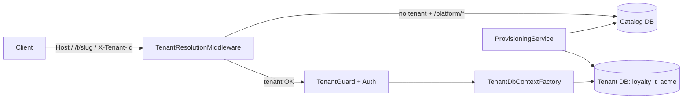

# Multiple-Tenant Loyalty System — Requirement & Architecture

> Audience: Product Manager → Senior Architect → Senior Developer.
> Stack: .NET 8+ API (`apps/api-dotnet`), PostgreSQL 15 (Npgsql), React 18 + Vite admin (`apps/admin`).
> Rule: simple, specific, implementable. No new microservices. No guessed requirements — unknowns are under **Open Questions**.

---

# PHASE 1 — PRODUCT REQUIREMENT (Product Manager / BA)

## 1. Business Problem & Justification

**Problem.** The loyalty platform today serves one business per deployment: a single PostgreSQL database, all tables shared, isolation only by a client-supplied `ProgramId`/`X-Program-Id` filtered in application code. Onboarding a second brand means a second deployment. There is no Super Admin, no tenant record, no per-tenant database, no domain/path isolation.

**Why multi-tenant.** One deployment must host many independent businesses (tenants), each with isolated data, its own domain or URL path, its own admin users, and its own loyalty configuration — while operations manages everything from one backoffice.

**Who benefits.**

- Operations / Super Admin: onboard a tenant in minutes without a new deployment.
- Tenant business (marketing/ops): self-contained loyalty program (members, points, rewards).
- End customers / POS / mobile: APIs scoped to exactly one tenant.
- Support / finance: per-tenant status, provisioning state, audit trail.

**Non-goals for v1.** Self-service signup, billing/metering, per-tenant feature flags, cross-tenant analytics, data-region pinning, tenant-specific custom schema. All out of scope.

---

## 2. Scope

### In scope (v1)

1. Super Admin login + tenant CRUD + enable/disable. **Login MUST use OIDC/OAuth2 SSO via a maintained library (Relying Party only); local email+password is a fallback, not the primary.**
2. Tenant resolution by exactly 3 supported strategies: **domain**, **URL path prefix**, **explicit tenant ID**.
3. Tenant creation with **Option A (domain mapping)** or **Option B (URL path)**.
4. Database provisioning: create DB if missing (plus schema), or validate + create missing tables / migrate if DB exists.
5. Tenant Admin login scoped to one tenant; minimal business + loyalty configuration to run the existing loyalty engine.
6. APIs + Admin UI (backoffice) for all of the above.
7. Tenant isolation enforcement (no cross-tenant reads/writes).

### Out of scope

Self-registration, payments/billing, per-tenant migrations UI, custom per-tenant code, multi-region, tenant rename of database after creation.

---

## 3. Actors & Roles

| Role | Scope | Can | Cannot |
|---|---|---|---|
| **Super Admin** (`SUPER_ADMIN`) | Global (catalog DB) | Login to ops backoffice; create/view/update/enable-disable tenants; configure DB connection + schema + resolution; view provisioning status; retry provisioning; manage super-admin accounts | Access tenant loyalty data except via explicit tenant-switch in read-only support view (v1: no switch — no tenant data access at all) |
| **Tenant Admin** (`TENANT_ADMIN`) | Exactly one tenant | Login to tenant backoffice; configure business + loyalty program; manage tenant operators/analysts; manage API keys for their tenant | Access any other tenant; change DB/resolution config; disable tenant |
| Operator / Analyst (existing roles) | Exactly one tenant | Operate per existing permissions (members, campaigns, etc.) | Same as Tenant Admin restrictions |

**Business rules.**

- BR-R1. Every admin user belongs to either global scope (Super Admin, `tenantId = null`) or exactly one tenant (`tenantId` non-null, immutable after creation).
- BR-R2. A Tenant Admin token is rejected if the resolved request tenant ≠ token tenant. No override header.
- BR-R3. Super Admin tokens carry no tenant; they can only call `/api/v1/platform/*` (tenant management). They cannot call tenant loyalty APIs.
- BR-R4. Disabling a tenant blocks all logins and all loyalty APIs for that tenant within 60 seconds (JWT carries `tenantStatus` version/check against cache).

---

## 4. Multi-Tenant Management (Functional Requirements)

### 4.1 Tenant record

Each tenant has exactly these fields (v1):

| Field | Type / constraint | Notes |
|---|---|---|
| `id` | string, CUID, PK, immutable, e.g. `tnt_abc123` | Public tenant ID used in strategy 3 |
| `name` | string 3–100, required, unique (case-insensitive) | e.g. `Acme Retail` |
| `slug` | string 3–50, `^[a-z0-9-]+$`, unique globally | e.g. `acme`; used for default path `/t/acme` |
| `status` | enum `PENDING \| ACTIVE \| DISABLED \| FAILED` | `PENDING` during provisioning |
| `resolutionMode` | enum `DOMAIN \| PATH \| TENANT_ID` | Primary method chosen at creation; tenant uses one; platform supports all three globally |
| `domain` | nullable, lowercase hostname, unique when set | e.g. `acme.loyalty.com`; required iff `resolutionMode=DOMAIN` |
| `pathPrefix` | nullable, `/t/{slug}` form, unique when set | e.g. `/t/acme`; required iff `PATH`; auto-default `/t/{slug}` |
| `deploymentMode` | enum `DEDICATED_DB \| SHARED_DB` (default `DEDICATED_DB`) | Dedicated = own Postgres DB; Shared = shared DB + `schema` |
| `dbName` | string, required | e.g. `loyalty_t_acme`; immutable after creation |
| `schema` | string, `^[a-z_][a-z0-9_]*$`, 1–63 chars, default `""` | Only used when `SHARED_DB`; e.g. `acme`; Postgres schema isolating the tenant's tables; immutable after creation |
| `dbStatus` | enum `NOT_STARTED \| PROVISIONING \| READY \| FAILED` | Updated by provisioning job |
| `dbError` | nullable text | Last provisioning error |
| `schemaVersion` | nullable string | Last applied migration ID |
| `contactEmail` | required email | Tenant owner |
| `createdAt / updatedAt` | UTC timestamps | |
| `createdBy` | admin user id | Audit |

**Business rules.**

- BR-T1. `slug`, `name`, `domain` (if set), `pathPrefix` (if set), `schema` (if set) are globally unique (case-insensitive for name/domain). `dbName` is unique only among `DEDICATED_DB` tenants — `SHARED_DB` tenants share one physical database, so their `dbName` is only a label and may repeat.
- BR-T2. `dbName` and `schema` are immutable after creation. `resolutionMode` change requires Super Admin + confirmation and must pass uniqueness re-validation.
- BR-T3. Tenant is usable only when `status=ACTIVE AND dbStatus=READY`.
- BR-T4. Disable sets `status=DISABLED` (data retained, all access blocked). Re-enable sets `ACTIVE` (no re-provisioning if `dbStatus=READY`).
- BR-T5. Delete is **soft-only v1**: Super Admin can only disable, not hard-delete. (Hard delete is Open Question.)

### 4.2 Super Admin workflows

- FR-SA1. Login via **OIDC SSO (OAuth2 authorization-code + PKCE, RP-only)**; email+password remains as fallback for break-glass. See §4.3 for the login requirement. Successful login returns the existing session artifact: Super Admin → short-lived JWT (global scope); Tenant Admin → tenant JWT with `tenantId` claim.
- FR-SA2. List tenants: paged, search by name/slug/domain, filter by `status`, `dbStatus`. Shows provisioning state.
- FR-SA3. Create tenant (see §6). On success tenant enters `PENDING / PROVISIONING` and provisioning starts automatically.
- FR-SA4. View tenant details + provisioning status/error + schema version.
- FR-SA5. Update tenant: `name, contactEmail, domain, pathPrefix, resolutionMode` (with re-validation). Cannot edit `dbName/schema/deploymentMode` after creation.
- FR-SA6. Enable / disable tenant (confirm dialog, reason recorded in audit).
- FR-SA7. Retry provisioning when `dbStatus=FAILED`.
- FR-SA8. View audit trail per tenant (who created/updated/disabled, when).

### 4.3 Login / Authentication Requirement (OIDC via OAuth2, library-based)

Applies to **both Super Admin (ops backoffice) and Tenant Admin (tenant backoffice)**. Member magic-link login is unchanged.

- FR-A1. **Primary login = OIDC SSO.** Both backoffices MUST offer "Login with SSO". The platform acts strictly as an **OAuth2 Relying Party (RP)**: authorization-code flow + PKCE (`S256`). No implicit/hybrid flows. The platform MUST NOT implement its own OIDC Provider/IdP (`/authorize`, JWKS hosting, consent server) in v1.
- FR-A2. **Use a maintained library, do not self-implement protocol crypto.** Backend: `Microsoft.AspNetCore.Authentication.OpenIdConnect` + `Microsoft.IdentityModel.Tokens` (already in the .NET stack). Discovery via `ConfigurationManager<OpenIdConnectConfiguration>` (cached + background refresh). Frontend MUST NOT validate tokens; it only handles redirects and stores nothing (JWT stays in memory; member session stays in `HttpOnly` cookie).
- FR-A3. **Flow (must be implemented exactly).**
  1. UI redirects to `GET /api/v1/{platform|admin}/oidc/{provider}/authorize` (tenant resolved first for tenant logins).
  2. Backend creates a single-use login session (`state` signed, `nonce`, PKCE `code_verifier`, 10-min expiry) and redirects to the IdP.
  3. IdP authenticates → `GET .../oidc/callback?code&state` → backend validates `state`, PKCE, then `id_token` (signature via JWKS, `iss`, `aud`, `exp`, `nonce`; `ClockSkew ≤ 2 min`).
  4. Backend links `(issuer, sub)` → local admin account (link on `(issuer, sub)` only; `email` claim links/merges **only if `email_verified=true`** from an allowlisted issuer, else create pending-link requiring verification), then mints the **existing** artifact (Super Admin JWT / tenant JWT) — no new token format.
  5. Disabled tenant or inactive admin → reject at callback with `TENANT_DISABLED` / `ACCOUNT_DISABLED`, never mint a token.
- FR-A4. **Provider configuration (per scope).** Ops scope: 1 generic OIDC provider row (Entra ID first; Google/Keycloak use the same generic shape: `issuer/discoveryUrl, clientId, allowedDomains?, claimMapVersion`). Tenant scope: each tenant may configure 0..1 providers (same shape, stored in catalog DB, secrets in vault/secret store, never in API responses or logs). Tenant login resolves provider by tenant, never by client-supplied issuer.
- FR-A5. **Fallback password login** (`POST .../auth/login`) stays for break-glass + environments without IdP. It uses the existing Argon2 verify + rate limit (10/min/IP) and is audited identically. Product may disable it per environment by flag.
- FR-A6. **Logout:** RP-initiated logout (`end_session_endpoint` when advertised) + local invalidation (JWT short-life/denylist for admin; session invalidate for members). IdP SSO logout is best-effort and documented as such.
- FR-A7. **Failure behavior (fail closed):** unknown `state`/reused `state`/bad `nonce`/bad signature/wrong `iss`/`aud`/expired token/IdP or JWKS outage → reject login with `OIDC_INVALID_TOKEN` / `PROVIDER_UNAVAILABLE`, audit the attempt, never fall back to an unauthenticated session. Login must degrade to password fallback when IdP is down (availability rule).
- FR-A8. **Security/PII:** never log `code, id_token, access_token, code_verifier, state`; metric labels = `provider, result` only (never `sub/email`); `client_secret` server-side only.
- FR-A9. **Login MUST be a separable Auth module.** All login/OIDC/password/session/account-linking code, models, tables, and dependencies MUST live inside a dedicated Auth module boundary (`LoyaltyOS.Auth.*`, tables `auth_*`, own migration set, own config section) so it can be extracted into a standalone Auth service later **without rewriting callers**. Loyalty/tenant code may only depend on the module's public ports (`IAuthService`, `ITokenValidator`, `IOidcLoginService`); it MUST NOT reference Auth internals, Auth tables, OIDC library types, or IdP secrets directly. See Phase 2 §17.1 for the enforced layout.

---

## 5. Tenant Resolution (Functional Requirements)

Three supported strategies. Each request resolves to **zero or one** tenant before auth.

| # | Strategy | How it resolves | When used |
|---|---|---|---|
| 1 | **Domain** | Exact match of HTTP `Host` (lowercased, port stripped) against `tenants.domain` | Production brand domains: `acme.loyalty.com`, `points.acme.com` |
| 2 | **URL path** | First path segment `/t/{slug}` matches `tenants.pathPrefix` | Shared-domain SaaS: `loyalty.com/t/acme/admin`, `loyalty.com/t/acme/api/...` |
| 3 | **Tenant ID** | Explicit `X-Tenant-Id: {id\|slug}` header, or route param `/api/{tenantId}/...` (header preferred) | Server-to-server / POS / mobile APIs, ops tooling |

**Resolution order (deterministic, must be implemented exactly).**

1. If `X-Tenant-Id` header or `{tenantId}` route value present → look up by `id` then `slug`. If present but unknown → **fail closed (404/unknown-tenant)**, do not fall through.
2. Else if `Host` matches a `DOMAIN`-mode tenant → that tenant.
3. Else if path starts with `/t/{slug}` → that tenant.
4. Else → unresolved.

**Rules.**

- BR-RS1. A tenant declares one primary `resolutionMode`, but the resolver implements all three globally (so POS can use header even for a DOMAIN tenant).
- BR-RS2. Domain and pathPrefix are globally unique; conflict → creation/update rejected.
- BR-RS3. Unresolved tenant → `404 { code: "UNKNOWN_TENANT" }`, no auth attempted, no DB touched beyond catalog lookup.
- BR-RS4. Resolved but `status != ACTIVE` → `403 { code: "TENANT_DISABLED" | "TENANT_NOT_READY" }`.
- BR-RS5. Resolved tenant ID is stored in `HttpContext.Items["Tenant"]` + JWT `tenantId` claim must equal it (except Super Admin platform routes which bypass tenant resolution).
- BR-RS6. Admin UI: ops backoffice runs on a fixed ops host (e.g. `admin.loyalty.com`, no tenant prefix). Tenant backoffice is accessed via tenant domain or `/t/{slug}/admin` and persists resolved tenant in memory (no localStorage tenant override).

---

## 6. Tenant Creation — Option A / Option B

Super Admin fills one form; chooses resolution:

**Option A — Domain mapping.** Input `domain` (e.g. `acme.loyalty.com`). System validates hostname, checks global uniqueness, stores it. Tenant accessed at `https://{domain}/...`.

**Option B — URL path.** Input slug (e.g. `acme`) → `pathPrefix = /t/acme`. Tenant accessed at `https://loyalty.com/t/acme/...`.

**Validation (creation + update).**

- V-C1. `name`: 3–100 chars, unique case-insensitive.
- V-C2. `slug`: 3–50, `^[a-z0-9-]+$`, unique; reserved words blocked: `admin, api, t, platform, health, metrics, docs, login, static`.
- V-C3. `domain` (Option A): valid hostname, ≤253 chars, lowercase, no scheme/path/port; must not equal ops domain or another tenant's domain; DNS ownership verification is **out of scope v1** (documented warning shown in UI).
- V-C4. `pathPrefix` (Option B): derived `/t/{slug}`, unique.
- V-C5. `contactEmail`: valid email.
- V-C6. `dbName`: auto-suggested `loyalty_t_{slug sanitized}` (≤63 chars, Postgres limit), editable, `^[a-z_][a-z0-9_]*$`, unique among `DEDICATED_DB` tenants (shared tenants reuse one database, so their `dbName` is only a label), and must not collide with existing catalog Postgres DB names unless operator confirms reuse (see §7).
- V-C7. `deploymentMode`: default `DEDICATED_DB`. If `SHARED_DB`, `schema` required `^[a-z_][a-z0-9_]*$` (1–63 chars, not `public`/`pg_*`/`information_schema`), unique among tenants.
- V-C8. Duplicate domain/path/slug/name/dbName → `409 CONFLICT` with field-level error; UI shows inline message, no partial tenant left behind (creation is transactional in catalog DB; provisioning is async after).

---

## 7. Tenant Database Provisioning (Functional Requirements)

Goal flow: `Add Tenant → PROVISIONING → READY → Tenant Ready`.

- FR-P1. On tenant creation, system enqueues a provisioning job (durable, retryable) and returns `202` with `status=PENDING, dbStatus=PROVISIONING`.
- FR-P2. Job steps:
  1. Insert/verify catalog tenant row (already done in request transaction).
  2. **If DB does not exist** (`DEDICATED_DB`): `CREATE DATABASE {dbName}` (as privileged provisioning role), then apply full EF Core migration set to that DB, then seed minimal rows (see FR-P3). **If `SHARED_DB`**: stay in shared DB, `CREATE SCHEMA IF NOT EXISTS {schema}`, apply the same migration set with schema-stamped DDL + per-schema `__EFMigrationsHistory`, then seed.
  3. **If DB already exists** (operator chose reuse): connect, verify connectivity + version; run `MigrateAsync()` (applies only missing migrations); verify all required tables exist (query `information_schema`); never drop/alter data tables destructively.
  4. Set `dbStatus=READY, status=ACTIVE, schemaVersion=<latest>`. On any failure: `dbStatus=FAILED, status=FAILED`, store `dbError`, keep catalog row.
- FR-P3. Seed on fresh provision: one default `Program` (`{name: "{TenantName} Rewards", pointsUnit from loyalty config default}`), one default `PointRule` (1 pt / $1), one `TENANT_ADMIN` bootstrap account (temporary password, must rotate on first login) — only if Tenant Admin email supplied at creation.
- FR-P4. Provisioning is idempotent: re-running with same `tenantId` never creates a second DB; retry resumes from last step.
- FR-P5. Failure handling: connection failure, `CREATE DATABASE` permission failure, migration failure, seed failure → `FAILED` + actionable `dbError` + Super Admin **Retry** button. No automatic destructive rollback of an existing reused DB; a newly created DB that fails migration may be left in place and retried (not auto-dropped, to allow inspection).
- FR-P6. Concurrency: only one provisioning job per tenant at a time (distributed lock by `tenantId`); tenant list polls `GET /platform/tenants/{id}` for status.

---

## 8. Loyalty Business Configuration (Tenant Admin)

Minimum to "run loyalty" — maps 1:1 to entities that already exist in the current system. Tenant Admin must complete these before the tenant is operable; UI shows a checklist + `configStatus`.

| # | Configuration | Fields (v1) | Backed by (existing entity) |
|---|---|---|---|
| C1 | Business info | business name, contact email, default locale, timezone, currency | Tenant row + `Program` |
| C2 | Program info + status | program name, description, points unit (e.g. PTS), logo URL, `isActive` | `Program` (default program auto-created at provisioning) |
| C3 | Member config | enrollment fields required (email/phone), duplicate policy (email unique per tenant), magic-link enabled | Existing member/enrollment behavior |
| C4 | Earn rules | ≥1 active `PointRule`: event name, points per unit, cap/window | `PointRule` |
| C5 | Redemption rules | ≥1 redeemable `Reward`: name, cost, stock/limits, `isActive` | `Reward` |
| C6 | Tiers (optional v1) | tier name, threshold, multiplier — may be skipped | `Tier` |
| C7 | API access | issue/rotate API key for POS/mobile | `ApiKey` (must become tenant-bound, see Phase 2) |

**Rules.**

- BR-L1. `configStatus`: `INCOMPLETE` until C1+C2+C4+C5 valid; then `READY`. Loyalty earn/redeem APIs return `403 PROGRAM_NOT_READY` while `INCOMPLETE` (except config APIs themselves).
- BR-L2. Points unit immutable once any `PointTransaction` exists.
- BR-L3. Deactivating program (`Program.isActive=false`) blocks earn/redeem but allows reads and config.
- BR-L4. All loyalty data is tenant-scoped; Tenant Admin sees only their tenant (enforced server-side, not just UI filtering).

---

## 9. API Requirements (Phase 1 — what, not how)

Base URLs:

- Platform (Super Admin, no tenant): `https://admin.loyalty.com/api/v1/platform/...`
- Tenant loyalty: `{tenant-base}/api/v1/...` where `{tenant-base}` = `https://{domain}` or `https://loyalty.com/t/{slug}`. `X-Tenant-Id` header accepted as alternative.

### 9.1 Platform APIs (Super Admin only, JWT `role=SUPER_ADMIN`)

| Method & Endpoint | Auth | Request | Response | Errors |
|---|---|---|---|---|
| `POST /platform/auth/login` | none (rate-limited, fallback/break-glass) | `{ email, password }` | `{ token, expiresIn, admin: { id, email, name } }` | 401 invalid credentials |
| `GET /platform/oidc/{provider}/authorize` | none (rate-limited) | — (starts OIDC per §4.3, `provider` allowlisted) | `302` redirect to IdP | 404 unknown provider |
| `GET /platform/oidc/callback` | none (rate-limited) | `?code&state` from IdP | sets/returns Super Admin JWT (same shape as login) + redirect to ops UI | `OIDC_INVALID_TOKEN`, `PROVIDER_UNAVAILABLE`, `ACCOUNT_DISABLED` |
| `POST /platform/auth/logout` | Super Admin | — | RP-initiated logout + local invalidation | — |
| `POST /platform/tenants` | Super Admin | `{ name, slug, resolutionMode, domain?, contactEmail, deploymentMode?, dbName?, schema? , bootstrapAdminEmail? }` | `202 { id, slug, status: PENDING, dbStatus: PROVISIONING }` | 400 validation, 409 duplicate (field in `details.field`) |
| `GET /platform/tenants?page&pageSize&q&status` | Super Admin | query params | `{ items: [{ id,name,slug,status,dbStatus,resolutionMode,domain,pathPrefix,dbName,schemaVersion,createdAt }], total }` | 400 bad filter |
| `GET /platform/tenants/{id}` | Super Admin | — | full tenant incl. `dbError, schemaVersion, audit` | 404 unknown tenant |
| `PATCH /platform/tenants/{id}` | Super Admin | `{ name?, contactEmail?, domain?, pathPrefix?, resolutionMode?, status? }` (no db fields) | updated tenant | 400/409; 422 if immutable field sent |
| `POST /platform/tenants/{id}/disable` | Super Admin | `{ reason }` | `{ id, status: DISABLED }` | 404/409 already disabled |
| `POST /platform/tenants/{id}/enable` | Super Admin | — | `{ id, status: ACTIVE }` (requires `dbStatus=READY`) | 422 db not ready |
| `POST /platform/tenants/{id}/provision:retry` | Super Admin | — | `202 { dbStatus: PROVISIONING }` | 409 already provisioning; 422 already READY |
| `GET /platform/tenants/{id}/provision` | Super Admin | — | `{ dbStatus, schemaVersion, dbError, updatedAt }` | 404 |

### 9.2 Tenant config APIs (Tenant Admin, tenant-resolved + JWT `tenantId` match)

| Method & Endpoint | Request | Response |
|---|---|---|
| `GET /admin/config` | — | `{ business, program, configStatus, checklist }` |
| `PUT /admin/config/business` | `{ businessName, contactEmail, defaultLocale, timezone, currency }` | updated + checklist |
| `PUT /admin/config/program` | `{ name, description, pointsUnit, logoUrl, isActive }` | updated program |
| `PUT /admin/config/earn-rules` | `{ rules: [{ event, pointsPerUnit, cap?, window? }] }` | created/updated rules |
| `PUT /admin/config/rewards` | `{ rewards: [{ name, cost, stock?, isActive }] }` | created/updated rewards |
| `POST /admin/auth/login`, `GET /admin/me` | existing semantics + tenant scope (password fallback) | JWT now includes `tenantId` |
| `GET /admin/oidc/{provider}/authorize` | none, tenant-resolved first | starts tenant OIDC per §4.3 | `302` to IdP / `TENANT_DISABLED` |
| `GET /admin/oidc/callback` | none, tenant-resolved first | `?code&state` | tenant JWT (`tenantId` bound) + redirect / errors as above |
| `GET /platform/oidc/providers`, `PUT /platform/oidc/providers/{name}` | Super Admin | `{ issuer, discoveryUrl, clientId, allowedDomains? }` (secret via vault, never in body response) | provider config (secret redacted) |
| `GET /admin/oidc/providers`, `PUT /admin/oidc/providers/{name}` | Tenant Admin (own tenant) | same shape, tenant-scoped | provider config (secret redacted) |

All existing loyalty endpoints (`/members`, `/events`, `/rewards`, ...) keep paths; they gain tenant resolution + `403` cases below. No path renames in v1.

### 9.3 Common error model (both surfaces)

```json
{ "error": { "code": "UNKNOWN_TENANT", "message": "...", "details": { "field": "domain" } } }
```

Codes: `UNKNOWN_TENANT, TENANT_DISABLED, TENANT_NOT_READY, PROGRAM_NOT_READY, DUPLICATE_TENANT, VALIDATION_ERROR, PROVISION_FAILED, FORBIDDEN_TENANT, UNAUTHORIZED, OIDC_INVALID_TOKEN, PROVIDER_UNAVAILABLE, ACCOUNT_DISABLED`.

---

## 10. Admin UI Requirements (Backoffice)

### 10.1 Super Admin UI (route base: `admin.loyalty.com`, no tenant prefix)

| Screen | Purpose | Main fields / actions | Validation / auth |
|---|---|---|---|
| Login | Global login | **SSO button (primary)** + email/password fallback → JWT (memory only); OIDC redirect handled by backend | Rate-limit message; 401 inline; `PROVIDER_UNAVAILABLE` shows "SSO down, use password" |
| Tenant list | Ops overview | table: name, slug, domain/path, status, dbStatus, updated; search + status filter; **New tenant** button; row → details | Super Admin only; polling `provision` while `PROVISIONING` |
| Create tenant | Provision | name, slug, resolution radio (Domain/Path), domain or auto path preview, deployment radio (Dedicated/Shared + schema), dbName (prefilled), contactEmail, bootstrap admin email; **Create** → toast + redirect to details | Inline uniqueness errors; immutable-field hint; confirm before submit |
| Tenant details | Status + config | read-only infra block (id, dbName, schema, schemaVersion) + editable block (name, contact, domain/path/mode) + `dbError` banner + **Retry provisioning / Enable / Disable** | Disable requires reason modal; infra fields disabled |
| Provisioning status | Ops | badge (`PROVISIONING/READY/FAILED`), spinner, error text, retry | Auto-refresh 5s while provisioning |

### 10.2 Tenant Admin UI (route base: tenant domain or `/t/{slug}/admin`)

| Screen | Purpose | Main fields / actions |
|---|---|---|
| Login | Tenant login | **SSO button (primary)** + email/password fallback; tenant derived from domain/path/header — **no tenant picker**; error if tenant disabled | OIDC `state/nonce` handled server-side; UI only redirects |
| Setup checklist | Onboarding | checklist C1–C5 with links; `configStatus` banner |
| Business config | C1 | business name, email, locale, timezone, currency; Save |
| Program settings | C2 | name, description, points unit (locked after first transaction), logo, active toggle |
| Earn rules / Rewards | C4–C5 | simple tables + add/edit; at least one of each to reach READY |
| API keys | C7 | list, issue, revoke (names only; secret shown once) |

All tenant screens: resolve tenant first; `UNKNOWN_TENANT / TENANT_DISABLED` → full-page error, no login form. Tenant context shown in header (tenant name). No cross-tenant switcher in v1.

---

## 11. Non-Functional / Security Requirements (Phase 1)

- NFR1. Tenant lookup (domain/path/id) < 50 ms p95, cached in memory (30 s TTL) with invalidation on tenant update.
- NFR2. Provisioning p95 < 3 min for fresh DB (excludes cloud DB latency); status pollable.
- NFR3. Isolation: 100% of tenant data queries constrained by resolved tenant; verified by tests inserting same `slug`/email in two tenants.
- NFR4. Secrets: tenant DB connection strings / passwords in vault or env-injected secret store, never returned by APIs, never logged.
- NFR5. Audit: every platform mutation (create/update/disable/enable/retry) + tenant config change logged with actor, tenant, timestamp.
- NFR6. Availability: unknown/disabled tenant fails fast without opening tenant DB connections.

---

## 12. Acceptance Criteria (Given/When/Then, excerpt)

1. `Given` SSO configured `When` Super Admin completes OIDC flow `Then` JWT minted with `role=SUPER_ADMIN, tenantId=null`; `Given` IdP returns bad signature/wrong `aud`/reused `state` `Then` 400 `OIDC_INVALID_TOKEN`, no session.
2. `Given` super admin break-glass credentials `When` POST `/platform/auth/login` with valid creds `Then` 200 + JWT with `role=SUPER_ADMIN, tenantId=null`.
3. `Given` no tenant `acme` `When` POST `/platform/tenants` (Option A, domain `acme.loyalty.com`, dedicated DB new) `Then` 202 + `PENDING/PROVISIONING`, and within minutes `READY/ACTIVE` with new Postgres DB + migrated tables + default program.
4. `Given` tenant `acme` READY `When` POST same domain again `Then` 409 `DUPLICATE_TENANT (domain)`.
5. `Given` tenant DB `loyalty_t_acme` already exists with old schema `When` provisioned with reuse `Then` missing migrations applied, no data loss, `READY`.
6. `Given` request `Host: acme.loyalty.com` `When` GET tenant API `Then` tenant `acme` resolved; `Given` unknown host `Then` 404 `UNKNOWN_TENANT`.
7. `Given` disabled tenant `When` any tenant API or login (SSO or password) `Then` 403 `TENANT_DISABLED`.
8. `Given` tenant admin of `acme` with valid JWT `When` calling API resolved to `beta` `Then` 403 `FORBIDDEN_TENANT`.
9. `Given` fresh tenant `When` earn API called before C1+C2+C4+C5 complete `Then` 403 `PROGRAM_NOT_READY`.
10. `Given` two tenants with same member email `When` each enrolls `Then` both succeed, each visible only in its tenant.

---

## 13. Requirement Review & Open Questions

Self-review applied: ambiguous "flexible tenant management" replaced with exact fields/endpoints; duplicate handling, failure modes, resolution priority, immutability defined; no invented billing/regions.

**Open Questions / Decisions Required (do not assume).**

1. Ops domain + wildcard DNS + TLS strategy for per-tenant domains (who issues certs)?
2. Postgres hosting: same server for all tenant DBs, or per-plan servers? Max DBs per server?
3. Is hard-delete of a tenant (drop DB) ever allowed, and with what approval?
4. DNS ownership verification for custom domains in v1 or deferred?
5. Should one tenant host multiple loyalty programs, or is 1 tenant = 1 program (+ future multi-program)?
6. Migrate existing single-DB data into `(default tenant + dedicated DB)` or keep legacy deployment read-only?
7. OIDC IdP choice for MVP (Entra ID vs Google vs Keycloak) and who owns IdP tenant/app registrations + `client_secret` rotation?

---
---

# PHASE 2 — ARCHITECTURE & DETAILED DESIGN (Senior Architect)

Design strictly implements Phase 1. Simplest viable: **monolith + catalog DB + database-per-tenant (Postgres) + optional shared-DB schema mode**, no new services.

## 14. Architecture Overview

```
Browser/POS/Mobile
  │  Host: acme.loyalty.com  |  loyalty.com/t/acme/...  |  X-Tenant-Id: tnt_xxx
  ▼
ASP.NET Core (single deployment)
  ├─ TenantResolutionMiddleware  → Catalog (cached) → HttpContext TenantContext
  ├─ /platform/*  (Super Admin JWT, Catalog DB only, no tenant)
  └─ /api/v1/* + /admin/* (Tenant JWT/API-key, Tenant DB via TenantDbContextFactory)
       ├─ Controllers (existing, + tenant guard)
       ├─ Services (existing logic, DbContext injected per-tenant)
       └─ Tenant databases (one Postgres DB per tenant; or shared DB + one schema per tenant)
Catalog PostgreSQL DB ("loyalty_catalog"): platform tables (Tenants, AuditLog, ProvisioningJobs) + Auth-module tables (`auth_*`, own `AuthDbContext`/migrations, separable later)
```

**Key decisions (why).**

- D1. *Database-per-tenant (default), shared-DB+schema as fallback.* Full row-level `tenantId` on every table is leak-prone given the current `ProgramId`-only filtering with trusted headers; per-DB gives hard isolation, per-tenant backup/restore, and matches the explicit requirement ("create db if not exist"). Schema mode covers cheap/small tenants without new infra — with native Postgres namespacing (indexes/constraints are schema-scoped, so no name mangling is needed, unlike the earlier prefix attempt in §27a).
- D2. *Catalog/tenant split.* Only tenant metadata + provisioning state lives in catalog; all loyalty tables live in tenant DBs unchanged. Keeps existing EF model/migrations reusable verbatim.
- D3. *Middleware resolution + per-request DbContext factory.* No `TenantId` column added to loyalty tables in v1 (avoids rewriting every entity/query); isolation comes from connecting to the right database. `X-Program-Id` trust hole is closed by deriving program scope from resolved tenant + JWT (see §19).
- D4. *No API path renames.* Tenant base (domain or `/t/{slug}` prefix stripped by middleware) keeps all existing `api/v1/*` routes working; Tedious client rewrites avoided.
- D5. *Async provisioning via hosted background job* (no Hangfire/queue infra in v1 — `IHostedService` + catalog-backed job row + `SELECT ... FOR UPDATE SKIP LOCKED` or in-memory channel for single-instance; Redis lock if scaled). Keeps ops simple.
- D6. *Login = OIDC RP via maintained library, not self-implemented protocol.* `Microsoft.AspNetCore.Authentication.OpenIdConnect` + `Microsoft.IdentityModel.Tokens` handle discovery/JWKS/signature/issuer/audience/lifetime; our code only wires tenant-scoped provider config, single-use `state/nonce/PKCE` store, `(issuer, sub)` linking, and minting the existing JWT/cookie. Rationale: protocol bugs (signature bypass, issuer confusion, replay) are the dominant SSO risk; a maintained library plus RP-only scope removes that surface. No IdP build-out.
- D7. *Auth is a module now, a service later — enforce the seam in v1.* All login code/models/tables/dependencies live in `LoyaltyOS.Auth.*` behind narrow ports, with Auth-owned tables (`auth_*`) and its own migration set, so extraction = move projects + split connection string, not a rewrite. Detail in §17.1.



Tenant request flow: `Request → Resolve (header→host→path) → Load TenantContext (cache) → Validate ACTIVE+READY → Auth (OIDC-RP JWT tenantId match, §4.3) → DbContext for tenant DB → Execute loyalty logic`.
Super Admin flow: `Login (SSO primary, password break-glass) → JWT(SUPER_ADMIN) → /platform/* → Catalog only → Enqueue provision → READY`.

## 15. Database Design

### 15.1 Catalog DB (`loyalty_catalog`) — NEW

Tenant/platform tables vs **Auth-module tables (`auth_*`, own EF migration set — separable to an `loyalty_auth` DB later, see §17.1)**:

| Table | Owner | Key columns | Constraints / indexes |
|---|---|---|---|---|
| `tenants` | Platform | `id PK (cuid, 'tnt_')`, `name`, `slug`, `status`, `resolutionMode`, `domain NULL`, `pathPrefix NULL`, `deploymentMode`, `dbName`, `schema`, `dbStatus`, `dbError NULL`, `schemaVersion NULL`, `contactEmail`, `createdBy`, `createdAt`, `updatedAt` | `UNIQUE(name CI)`, `UNIQUE(slug)`, `UNIQUE(domain) WHERE NOT NULL`, `UNIQUE(pathPrefix) WHERE NOT NULL`, `UNIQUE(dbName) WHERE deploymentMode='DEDICATED_DB'`, `UNIQUE(schema) WHERE <> ''`, `INDEX(status, dbStatus)` |
| `tenant_audit` | Platform | `id PK`, `tenantId FK→tenants`, `actorId`, `actorRole`, `action`, `reason NULL`, `diff JSONB NULL`, `createdAt` | `INDEX(tenantId, createdAt)` |
| `provisioning_jobs` | Platform | `id PK`, `tenantId FK UNIQUE (one active)`, `state (QUEUED/RUNNING/DONE/FAILED)`, `attempts`, `lastError NULL`, `lockedBy NULL`, `lockedAt NULL`, `createdAt`, `updatedAt` | `INDEX(state)` |
| `auth_admins` (replaces single-DB `AdminUsers` for ops scope) | Auth | `id PK`, `email UNIQUE CI`, `passwordHash (Argon2)`, `name`, `isActive`, `lastLoginAt` | `INDEX(isActive)` |
| `auth_oidc_providers` | Auth | `id PK`, `scope (PLATFORM\|TENANT)`, `tenantId FK→tenants NULL (null=platform)`, `name`, `issuer`, `discoveryUrl`, `clientId`, `secretRef (vault key, never secret)`, `allowedDomains JSONB`, `claimMapVersion`, `isActive`, `createdAt/updatedAt` | `UNIQUE(scope, tenantId, name)`, `INDEX(isActive)` |
| `auth_external_subjects` | Auth | `id PK`, `providerId FK→auth_oidc_providers`, `issuer`, `subject`, `adminUserId`, `emailVerifiedSnapshot`, `createdAt` | `UNIQUE(providerId, issuer, subject)`, `INDEX(adminUserId)` |
| `auth_login_sessions` | Auth | `id PK (state id)`, `nonceHash`, `pkceVerifier (hashed)`, `providerId`, `tenantId NULL`, `redirectUri`, `expiresAt (10 min)`, `usedAt NULL` | `INDEX(expiresAt)`, single-use (`usedAt` set on callback) |

Postgres CITEXT or `LOWER()` unique indexes for case-insensitive `name/email/domain`.

### 15.2 Tenant DB (`loyalty_t_{slug}` or shared DB + schema) — EXISTING schema reused

All current tables (`Program`, `Member`, `Event`, `PointAccount`, `PointTransaction`, `PointRule`, `Tier`, `Campaign`, `Segment`, `Coupon`, `Reward`, `Badge`, `AdminUser`, `ApiKey`, `Session`, `Coalition*`, `GiftCard*`, `WebhookSubscription`, `Notification*`, `IdempotencyRecord`) **unchanged in v1** — same EF model + same migrations applied per tenant DB or tenant schema.

- `DEDICATED_DB`: tables unqualified (`public` schema) in DB `{dbName}`.
- `SHARED_DB`: `modelBuilder.HasDefaultSchema(schema)` driven by `TenantContext.Schema` (model-cache key includes schema — see §17); migration DDL is schema-stamped at apply time and each schema keeps its own `__EFMigrationsHistory` (see §27b).
- `AdminUser.ProgramId` semantics: for tenant DBs, super-admin rows do not exist there; `AdminUser` rows are tenant admins bound to the tenant's default program (migration of meaning documented; no schema change v1).
- Seed: default `Program` + 1 `PointRule` + bootstrap `AdminUser(TENANT_ADMIN)` if email supplied.

### 15.3 ER (catalog)

```mermaid
erDiagram
  tenants ||--o{ tenant_audit : "has"
  tenants ||--o| provisioning_jobs : "provisions"
  auth_admins ||--o{ tenant_audit : "actor"
  tenants {
    string id PK
    string name UK
    string slug UK
    string status
    string resolutionMode
    string domain UK_NULL
    string pathPrefix UK_NULL
    string deploymentMode
    string dbName UK
    string schema UK_NONEMPTY
    string dbStatus
    text dbError
    string schemaVersion
  }
```

## 16. Application / Domain Models

| Model | Location | Purpose / key props | Ownership |
|---|---|---|---|
| `Tenant` | `Auth`-independent: `Core/Entities/Tenant.cs` (platform; new, catalog context) | All §4.1 fields; `IsUsable => Status==ACTIVE && DbStatus==READY` | Catalog (platform) |
| `TenantContext` | `Application/MultiTenancy/TenantContext.cs` (new, scoped) | `TenantId, Slug, DbName, Schema, DeploymentMode, ResolutionSource (Header/Host/Path)` | Per-request |
| `TenantResolutionResult` | same namespace | `Ok(TenantContext) / Unknown / Disabled / NotReady` + code | Per-request |
| `AuthAdmin` | `Auth.Core/Entities/AuthAdmin.cs` (Auth module owns; replaces ops-scope `AdminUser`) | `Email, PasswordHash, Name, IsActive` | Catalog (`auth_admins`) |
| `TenantAuditEntry` | `Core/Entities/TenantAudit.cs` | `TenantId, ActorId, Action, Reason, Diff` | Catalog |
| `Program`, `PointRule`, `Reward`, `AdminUser(TENANT_ADMIN)`, `ApiKey` | existing, unchanged | Loyalty config (§8); `ApiKey` becomes tenant-DB-scoped automatically | Tenant DB |
| `ProvisioningJob` | `Infrastructure/Provisioning/ProvisioningJob.cs` | `TenantId, State, Attempts, LastError` | Catalog |
| `OidcProvider` / `ExternalSubject` / `LoginSession` | `Auth.Core/Entities/*.cs` (Auth module owns; tables `auth_*`) | Provider config per scope; `(issuer, sub)→admin` link; single-use `state/nonce/PKCE` | Catalog (`auth_*`, separable) |

No `TenantId` column added to loyalty entities in v1 (isolation via database, not discriminator).

## 17. Backend Components (only what v1 needs)

| Component | New / Modify | Responsibility |
|---|---|---|
| `TenantResolutionMiddleware` | NEW `Application/MultiTenancy/` | Implements §5 order; strips `/t/{slug}` prefix and re-roots path; sets `HttpContext.Items["Tenant"]`; short-circuits `UNKNOWN_TENANT / TENANT_DISABLED / NOT_READY`; bypasses for `/platform/*`, `/healthz`, `/readyz`, `/metrics`, `/docs` |
| `ITenantStore` + `CachedTenantStore` | NEW | Catalog lookup by id/slug/host/path; `IMemoryCache` 30 s + invalidation on tenant write |
| `TenantContext` (scoped) + `RequireTenant` filter | NEW | Exposes resolved tenant to controllers/services; rejects cross-tenant JWT |
| `TenantDbContextFactory` (`Create(tenant)`) | NEW | Builds `LoyaltyDbContext` options with tenant connection string (+ `schema` via `DbContextOptionsExtension`/`HasDefaultSchema`/model cache key); caches `DbContextOptions` per tenant; never logs connection string |
| `CatalogDbContext` | NEW (small: 3 DbSets — platform only) | `Tenants, Audit, Jobs` on `loyalty_catalog` (Auth tables live in `AuthDbContext`, §17.1) |
| `TenantService` (CRUD + enable/disable + audit) | NEW | Validation §6, uniqueness checks, status transitions, cache invalidation |
| `ProvisioningService` (hosted worker) | NEW `Infrastructure/Provisioning/` | `CREATE DATABASE`, `MigrateAsync()`, `information_schema` table check, seed, status updates, per-tenant lock, retry |
| `DatabaseAdminService` | NEW | Privileged Npgsql connection (provisioning role from vault); `CREATE DATABASE` with identifier quoting; connectivity probe |
| `PlatformAuthService` + `PlatformAuthController` | NEW, **Auth module** (`Auth.Application/`, thin controller in API) | Super Admin password fallback (Argon2) → JWT (`role=SUPER_ADMIN`, no tenant); audited via `IAuditSink` port (no direct `tenant_audit` write) |
| `OidcAuthService` + `OidcCallbackController` (platform + tenant) | NEW, **Auth module**, library-backed | Wraps `OpenIdConnectHandler`: builds authorize redirect (signed `state`, `nonce`, PKCE), validates callback via library (JWKS/iss/aud/exp/nonce), enforces single-use login session, `(issuer,sub)` linking with `email_verified` rule, mints existing JWT; secrets from vault; callbacks rate-limited by IP |
| `TenantAuthService` changes | MODIFY | JWT gains `tenantId` (+ `role` incl. `TENANT_ADMIN`); login verifies tenant ACTIVE+READY and admin belongs to tenant DB |
| `LoyaltyDbContext` schema hook | MODIFY (small) | If `Schema != ""`, `HasDefaultSchema(schema)`; model cache key includes schema |
| `X-Program-Id` deprecation guard | MODIFY | Resolved tenant + JWT `programId` must match tenant's default program; raw header no longer trusted when JWT present |
| `PlatformTenantsController`, `TenantConfigController` | NEW controllers | §9 endpoints |
| Existing loyalty controllers/services | MODIFY (mechanical) | Replace directly-injected `LoyaltyDbContext` with factory/request-scoped tenant instance; add `[RequireTenant]`; map `PROGRAM_NOT_READY` guard via program `isActive`/checklist |

Request pipeline order: `Serilog → Security headers → TenantResolution → Cors → RateLimiter (partition: tenant+IP) → Auth → TenantGuard → Controllers`.

### 17.1 Auth Module Segregation (must be separable to a standalone service)

**Goal:** login/OIDC/password/session code, models, tables, and dependencies are physically isolated in v1 so a future split needs no caller rewrite.

**Code layout (new projects; no auth code outside them except thin controllers + ports).**

```
src/
  core/                               # loyalty bounded context
    LoyaltyOS.API/                    # loyalty traffic (members, points, rewards, …)
    LoyaltyOS.Application/            # loyalty use cases + shared MultiTenancy primitives
    LoyaltyOS.Core/                   # loyalty entities
    LoyaltyOS.Infrastructure/         # loyalty persistence + tenant provisioning workers
  auth_multi-tenant/                  # auth + multi-tenant bounded context (own host)
    LoyaltyOS.Auth.Core/              # entities ONLY: AuthAdmin, OidcProvider, ExternalSubject, LoginSession
    LoyaltyOS.Auth.Application/       # ports + use cases: IAuthService, ITokenValidator,
                                      #   IOidcLoginService, IPasswordVerifier, ISecretStore, IAuditSink,
                                      #   TenantStatusReader (port, implemented by platform)
    LoyaltyOS.Auth.Infrastructure/    # adapters: AuthDbContext, OidcAuthService, JwtMinter,
                                      #   Argon2Verifier, VaultSecretStore, EFCore stores
    LoyaltyOS.Platform.API/           # thin HTTP host: PlatformAuth, PlatformTenants,
                                      #   Oidc, TenantConfig, TenantAuth — map HTTP ↔ Auth ports, no business logic
```

**Dependency rules (enforced; add an architecture test).**

- ALLOWED: `API → Auth.Application` (ports only); `Auth.Infrastructure → Auth.Application + Auth.Core`; `Auth.Application → Auth.Core` + `Microsoft.AspNetCore.Authentication.OpenIdConnect / Microsoft.IdentityModel.*` (only inside `Auth.Infrastructure`).
- FORBIDDEN: loyalty/tenant/provisioning code referencing `Auth.Core`, `Auth.Infrastructure`, `auth_*` tables, OIDC library types, or IdP secrets; Auth code referencing `LoyaltyDbContext`, `TenantService`, loyalty entities, or `tenant_audit` directly. Cross-module needs go through ports:
  - `TenantStatusReader.IsUsable(tenantId)` (platform implements; Auth calls to reject disabled tenants),
  - `IAuditSink.Write(...)` (platform implements; Auth never writes audit tables),
  - `ITokenValidator.Validate(token)` (Auth implements; `TenantGuard`/loyalty code calls — JWT validation stays working after extraction via shared secret/JWKS endpoint, no logic change).

**Models:** §16 Auth entities live only in `Auth.Core`; loyalty code MUST NOT join or navigate to them. Tenant→Auth link is by scalar `tenantId` FK on `auth_oidc_providers` (no EF navigation to `tenants` from Auth side; no navigation from `tenants` to Auth tables).

**Database:** Auth owns `auth_admins, auth_oidc_providers, auth_external_subjects, auth_login_sessions` with **its own EF context (`AuthDbContext`) + own migration assembly** (`LoyaltyOS.Auth.Infrastructure/Migrations`). In v1 it shares the `loyalty_catalog` connection string (separate config key `Auth:ConnectionString`, default = catalog value); no cross-context joins, no shared transactions with platform tables. Future split = point `Auth:ConnectionString` at a new `loyalty_auth` DB and run the Auth migrations there — zero code change.

**Config/dependencies:** all Auth settings under `Auth:` (`Issuer allowlist, Jwt:SecretKey ref, IdP client secrets via vault refs only`); OIDC library, Argon2, and secret-store references are package/project references of `Auth.Infrastructure` only. Auth logging redacts tokens/secrets at the module edge (§4.3 FR-A8).

**Extraction path (when needed, no redesign):** move the 3 Auth projects + `Controllers/Auth/*` into a new `AuthService` host; keep route shapes (`/platform/auth/*`, `*/oidc/*`); loyalty API validates JWTs via `ITokenValidator` (remote JWKS / shared secret); `TenantStatusReader`/`IAuditSink` become HTTP/gRPC adapters behind the same interfaces. Contract tests on the ports (§24 SSO tests) run unchanged against the standalone service.

## 18. API Design (detailed deltas + contracts)

Conventions: platform routes `POST /api/v1/platform/...` require `Authorization: Bearer <super-admin JWT>` and **must not** send tenant headers. Tenant routes require tenant resolution (§5) + `Bearer <tenant JWT>` (or `X-API-Key` bound to tenant DB row) and return tenant error codes before auth errors. All `*/auth/*` and `*/oidc/*` endpoints are owned by the Auth module (§17.1): controllers are thin mappers over Auth ports, so the route contract survives extraction unchanged.

**`POST /api/v1/platform/auth/login`** — password fallback/break-glass: `{ email: string, password: string[8..128] }` → `200 { token, expiresIn: 28800, admin:{id,email,name} }` / `401 {INVALID_CREDENTIALS}` (Argon2 + dummy-hash timing guard, reuse existing pattern). Rate-limit 10/min/IP. May be disabled by env flag when SSO-only is required.

**OIDC (both scopes, RP-only, library-validated).** `GET .../oidc/{provider}/authorize` → `302` to IdP (`provider` must be allowlisted for that scope/tenant; tenant scope resolves tenant first). `GET .../oidc/callback?code&state` → library validates `id_token` (JWKS signature, `iss` exact-match to configured discovery issuer, `aud=clientId`, `exp`, `nonce`; `ClockSkew ≤ 2 min`; single-use `state`/PKCE) → link-or-create admin on `(issuer, sub)` (email-merge only if `email_verified=true`) → mint existing JWT shape. Errors: `400 OIDC_INVALID_TOKEN` (bad signature/iss/aud/nonce/expiry/reused state), `404 UNKNOWN_PROVIDER`, `403 TENANT_DISABLED/ACCOUNT_DISABLED`, `502 PROVIDER_UNAVAILABLE` (IdP/discovery/JWKS outage, fail closed). Callback rate-limited stricter than global. Secrets (`client_secret`) server-side only, from vault.

**`POST /api/v1/platform/tenants`** (Super Admin) — body §9.1; validation §6; `202 { id, slug, status:"PENDING", dbStatus:"PROVISIONING" }`; `400 VALIDATION_ERROR {details:{field, reason}}`; `409 DUPLICATE_TENANT {details:{field: name|slug|domain|pathPrefix|dbName|schema}}`; creates catalog row + enqueues job transactionally (outbox column on tenant row or `provisioning_jobs` insert in same tx).

**`GET /api/v1/platform/tenants`**, **`GET .../{id}`**, **`PATCH .../{id}`**, **`POST .../{id}/disable|/enable`**, **`POST .../{id}/provision:retry`**, **`GET .../{id}/provision`** — per §9.1. `PATCH` rejects `dbName/schema/deploymentMode` with `422 IMMUTABLE_FIELD`. `enable` requires `dbStatus=READY` else `422 DB_NOT_READY`. `provision:retry` requires `FAILED` else `409/422`.

**Tenant config** `GET /api/v1/admin/config`, `PUT /admin/config/{business|program|earn-rules|rewards}` — Tenant Admin (`TENANT_ADMIN`), tenant match enforced; `PUT program.pointsUnit` locked (`422 POINTS_UNIT_LOCKED`) once transactions exist; incomplete checklist → loyalty write APIs `403 PROGRAM_NOT_READY`.

**Existing loyalty APIs** — unchanged paths; added responses: `404 UNKNOWN_TENANT`, `403 TENANT_DISABLED / TENANT_NOT_READY / FORBIDDEN_TENANT / PROGRAM_NOT_READY`. Versioning: no v2; additive only.

## 19. Current-System Gap Analysis (verified against repo)

| Area | Current System (verified) | Required Change | Gap | Implementation |
|---|---|---|---|---|
| Database | Single Postgres (`loyaltyos_dev`, Npgsql, `LoyaltyDbContext` 1045 lines, `Program.cs:93-104` single connection string). No tenant DB, no schema override, no catalog. Isolation = `ProgramId` string column filtered per-query; unique keys `{ProgramId, Key}` | Catalog DB + per-tenant DBs (+ schema for shared mode) | **Large** — no multi-DB infra, no provisioning, no catalog | New `CatalogDbContext`, `TenantDbContextFactory`, `ProvisioningService`, `DatabaseAdminService`; schema hook in `OnModelCreating` |
| Migrations | `Infrastructure/Migrations/` (InitialCreate + Idempotency + batch fix), applied to single DB | Same migration set applied per tenant DB + `schemaVersion` tracked in catalog | **Medium** — set reusable, runner missing | `MigrateAsync()` per tenant in provisioning; record migration ID |
| API | `api/v1/*` controllers (`AdminAuth, AdminPrograms, Members, Events, Rewards, Coupons, Tiers, Campaigns, Badges, Giftcards, Coalition, Webhooks, Stats, Idempotency`); no `/platform/*`, no tenant routes | Add platform + config controllers; tenant-scope all existing | **Medium** — additive controllers + mechanical DbContext wiring | New controllers §17; keep all existing paths |
| Authentication | JWT HMAC (`JwtService`, 8h admin/30d member), claims `{role, programId, type}`; roles `SUPER_ADMIN/OPERATOR/ANALYST` exist but **no policy enforcement** (`AddAuthorization()` empty); scoping via trusted `X-Program-Id` header fallback; `X-API-Key` only a rate-limit key, no DB validation. **No OIDC/OAuth2**: only local password (admin, Argon2) + magic-link (member); no `OpenIdConnect` handler, no provider/JWKS code. **No Auth seam**: auth code mixed into API/services, no separate projects/contexts | OIDC SSO primary (RP-only, `OpenIdConnect` library, isolated in `LoyaltyOS.Auth.*`, §17.1) + password break-glass; JWT `tenantId` claim + enforced policies; Super Admin global vs Tenant Admin bound; API keys validated against tenant DB hash; new `auth_*` tables with own `AuthDbContext`/migrations | **Large (security + structure)** — trust model must change + SSO is greenfield + Auth must be carved out as a module | New `Auth.*` projects + `AuthDbContext`; `OidcAuthService`/callbacks + platform login behind ports; enforce `[Authorize(Roles)]` + tenant-match filter; bind API keys; stub-OIDC-issuer (WireMock + static JWKS) tests; arch test on dependency rules |
| Tenant resolution | None — no host/path/tenant-id resolution; `X-Program-Id` passthrough | Middleware §5 + cache + prefix strip | **Large — absent** | `TenantResolutionMiddleware` + `CachedTenantStore` |
| Loyalty configuration | Entities exist (`Program, PointRule, Reward, Tier, ApiKey`) but no setup checklist, no `READY` gate, no tenant bootstrap/seed | Default program seed + checklist + `PROGRAM_NOT_READY` guard | **Small–Medium** | Seed in provisioning; `TenantConfigController` + guard filter |
| Admin UI | `apps/admin` (React 18/Vite/TQ5, routes `/login,/,/members,/campaigns,/coupons,/segments,/badges,/tiers,/rewards,/coalition*,/giftcards*,/developer*`); `api-client.ts` in-memory creds + `VITE_API_URL/API_KEY/PROGRAM_ID`; dev proxy `/api→:5101`; no tenant concept, no platform screens | Ops app (platform) + tenant-aware app (resolve + checklist + config pages) | **Large** — new pages/routes/context, shared components reusable | New `apps/admin` routes §20; `TenantProvider`; keep existing loyalty pages, scope queries by tenant |
| Observability/ops | Serilog, Prometheus `/metrics`, `/health`, rate limiter 1000/min by key/IP | Partition rate limit by tenant; per-tenant provisioning metrics; audit log | **Small** | Extend existing hooks; `tenant_audit` table |

Do not treat `Program` as the tenant: `Program` remains the loyalty program *inside* a tenant (default 1 per tenant in v1). `AdminUser.ProgramId` (non-nullable string, `Restrict` FK) continues to work unchanged inside tenant DBs.

## 20. Admin UI Design (React, `apps/admin`)

**Routes.**

- Ops (no tenant): `/platform/login`, `/platform/tenants`, `/platform/tenants/new`, `/platform/tenants/:id` (guards: `RequireSuperAdmin`).
- Tenant: `/t/:slug/*` prefix stripped for API but kept for routing: `/t/:slug/login`, `/t/:slug/setup`, `/t/:slug/settings/*` (guards: `RequireTenant` + tenant-match with JWT).

**State/API.**

- `TenantProvider`: resolves tenant (host/path/header), exposes `{ tenant, status, configStatus }`; blocks render on `UNKNOWN/DISABLED`.
- Login pages: **SSO button → full redirect** to backend `.../oidc/{provider}/authorize`; backend callback mints JWT and redirects to UI (no tokens in URL). Password form kept as secondary.
- TanStack Query keys namespaced: `["tenant", slug, "config"]`, `["platform", "tenants", filters]`; `api-client.ts` extended: `platformFetch()` (super JWT) + `tenantFetch()` (auto `X-Tenant-Id`, strip `/t/:slug` before send only if backend expects root — else send through).
- Forms (React Hook Form + Zod): tenant create (resolution radio, domain/path preview, dbName prefill, schema field conditional), business/program/earn/reward forms; server 409 mapped to field errors.
- **Needs codebase inspection:** exact shadcn form/table primitives and `developer*` API-key page shape before reuse — confirm during implementation.

## 21. Implementation Plan (senior-dev sequence)

1. **Catalog + Auth seam first**: `CatalogDbContext` + migration (`tenants, tenant_audit, provisioning_jobs`); **`AuthDbContext` + own migration (`auth_admins, auth_oidc_providers, auth_external_subjects, auth_login_sessions`)** with `Auth:ConnectionString` key (default = catalog); seed one Auth admin (env password); vault keys + IdP client secrets. Add architecture test for §17.1 dependency rules.
2. **Tenant domain + store**: `Tenant` entity, `ITenantStore`/`CachedTenantStore`, uniqueness validation, audit writer.
3. **Resolution**: `TenantResolutionMiddleware` (+ path strip, bypass list) + `TenantContext` + `RequireTenant`/tenant-match filter + error codes; integration tests for order §5.
4. **Provisioning**: `DatabaseAdminService` + `ProvisioningService` worker + retry/status endpoints; test fresh-create, reuse-existing, migration-gap, failure→retry.
5. **AuthZ + SSO (inside Auth module, §17.1)**: platform password fallback + OIDC RP (`OidcAuthService`, single-use login sessions, JWKS caching) + JWT `tenantId`/`role` claims; enforce policies; bind API keys to tenant DB; remove trust in raw `X-Program-Id` when JWT present. Test with stub OIDC issuer (static JWKS) incl. rotation + `email_verified=false` attack case.
6. **Platform APIs** §9.1 + **tenant config APIs** §9.2 + `PROGRAM_NOT_READY` guard.
7. **Admin UI**: ops screens then tenant screens (§10/§20); wire polling + field-error mapping.
8. **Loyalty cutover**: factory-backed `DbContext` in all services; cross-tenant tests (same email/slug in 2 tenants); checklist E2E `login→provision→configure→earn→redeem`.
9. **Rollout**: deploy catalog + code (tenant path disabled by flag `MultiTenancy:Enabled`), provision `default` tenant from existing DB data (Open Question 6), enable per-domain cutover, monitor `provision_*` metrics.

## 22. Security

- Isolation: tenant DB credentials resolved server-side from catalog `dbName` (never from client); connection-string template in vault (`TENANT_DB_TEMPLATE`), password per logical role; `REQUIRE` tenant-match before any tenant DB connection is opened.
- AuthN/Z: OIDC RP via maintained library (no self-implemented protocol crypto); Argon2id password fallback; JWT short-lived (8h admin); `tenantId` claim verified on every tenant request; Super Admin cannot present a tenant; disabled-tenant JWTs rejected via `status` cache check. Link only on `(issuer, sub)`; email-merge only if `email_verified=true` from allowlisted issuer.
- Spoofing: `Host` values normalized + allow-listed against catalog (no regex routing); path `/t/{slug}` slug charset enforced; `X-Tenant-Id` unknown → fail closed, no fallback.
- Secrets: connection strings never in responses/logs; `dbError` scrubbed of credentials; API key secrets shown once, stored as hash (reuse existing `ApiKey.KeyHash` pattern).
- Audit: `tenant_audit` on all platform mutations + tenant config writes (actor, IP, diff); provisioning attempts logged with redaction.

## 23. Error & Failure Handling

| Case | HTTP | Behavior |
|---|---|---|
| Unknown tenant (bad host/path/id) | 404 `UNKNOWN_TENANT` | No auth, no tenant DB connection |
| Disabled tenant | 403 `TENANT_DISABLED` | Login + APIs blocked; UI full-page notice |
| Provisioning / not ready | 403 `TENANT_NOT_READY` / `PROGRAM_NOT_READY` | Status endpoints still work; retry offered (ops) / checklist shown (tenant) |
| Duplicate tenant field | 409 `DUPLICATE_TENANT {field}` | Field-level UI error; no partial row (request tx rolled back) |
| DB create failure (perms/network/name) | tenant `FAILED`, `dbError` set | Super Admin retries; new empty DB left for inspection, never auto-wipes reused DB |
| Migration failure | `FAILED`, `schemaVersion` = last good | Retry resumes; migrations transactional per migration (EF default); verify via `information_schema` |
| Invalid config (points unit lock, bad rules) | 422 `VALIDATION_ERROR`/`POINTS_UNIT_LOCKED` | Inline errors; no partial writes (transaction per PUT) |
| Cross-tenant access (JWT≠resolved) | 403 `FORBIDDEN_TENANT` + audit | Token revoked on repeated abuse (ops playbook) |
| OIDC callback invalid (bad signature/iss/aud/nonce/expiry/reused state) | 400 `OIDC_INVALID_TOKEN` | No session minted; audit; user may retry login |
| IdP / discovery / JWKS outage | 502 `PROVIDER_UNAVAILABLE` | Fail closed; UI offers password fallback; alert fires |
| Catalog DB down | 503 (both surfaces) | Tenant APIs fail closed; readiness probe fails |

Idempotency: tenant creation keyed by `slug` (double-submit safe); provisioning job single-flight per tenant; config PUTs transactional.

## 24. Testing Map (to acceptance criteria §12)

- Contract tests: all §9 endpoints (auth, CRUD, errors, immutable-field rejection).
- Resolution tests: header/host/path priority, unknown→404, disabled→403, prefix-strip routing.
- Provisioning tests: fresh DB, reuse + schema gap, failure injection + retry, concurrency single-flight (Testcontainers Postgres recommended).
- Isolation tests: same email/code/slug in two tenants; JWT swap → 403; Super Admin → tenant API denied.
- E2E: `super login → create → READY → tenant login → checklist → earn → redeem → disable → 403`.
- SSO: stub-issuer authorize→callback happy path; AC-1–AC-5 from LR-130 (state/nonce/PKCE/iss/aud/signature, invalid-token reject, `(issuer,sub)` linking without trusting unverified email, logout invalidation, rotation observability).

---

## Appendix — Decisions / Open Questions (carried from §13)

Defaults chosen: 1 tenant = 1 default program; dedicated DB default; no hard delete v1; DNS verification deferred with UI warning. Items 1–6 in §13 still require ops/business confirmation before GA (especially existing-data migration strategy and Postgres fleet sizing).

## 25. Implementation Record (approved during build)

1. **One database, segregated projects.** Tenant management + Auth share the physical catalog database (approved). Split-readiness kept via `CatalogDbContext` vs `AuthDbContext`, separate migration sets, and separate config keys (`ConnectionStrings:CatalogConnection`, `Auth:ConnectionString`, `ConnectionStrings:TenantTemplate`, `ConnectionStrings:ProvisioningConnection`).
2. **OIDC RP via `Microsoft.IdentityModel` (generic).** No custom protocol crypto; Keycloak/Entra/Google-compatible provider rows + management UI. Full OpenIddict-server mode deferred.
3. **Hard rename `program-id` → `tenant-id` (breaking, as approved).** `X-Tenant-Id` header (old header rejected), JWT claim `tenantId`, `RenameProgramIdToTenantId` migration (25 pure `RenameColumn`, data + FKs preserved, verified live), frontend types renamed. `MultiTenancy:Enabled=false` default keeps legacy single-tenant behavior until rollout.
4. **Custom connection string at creation.** Accepted per-tenant (`vault:KEY` ref preferred; direct string stored in catalog for dev/simple ops, resolved server-side only).
5. **Routing fix.** Explicit `UseRouting()` after `TenantResolutionMiddleware` — implicit routing otherwise matches the unstripped `/t/{slug}` path (found by live test).
6. **Follow-ups (not in this slice).** Bootstrap admin password rotation endpoint; tenant-side OIDC callback account linking UI; DNS ownership verification; hard-delete policy.

## 26. Extraction Record — separate Platform API (built end of slice)

Auth + multi-tenant now run as their own host **`LoyaltyOS.Platform.API`** (port 5121 in dev; `VITE_PLATFORM_API_URL` selects it in Admin UI):

- Hosts: `platform/auth/*` (Super Admin login/me/logout), `platform/tenants/*` (CRUD, enable/disable, provision status/retry, **admin-credentials rotation**), `platform/oidc/*` (authorize/callback, provider CRUD), `admin/oidc/*` (tenant authorize/**callback**, provider CRUD), `admin/config/*`, **`admin/auth/login|me`** (tenant-DB password login minting the TENANT id).
- Shared seam: `LoyaltyOS.Application/MultiTenancy` (resolution middleware, `RequireTenant`, tenant HTTP helpers — FrameworkReference, no host dependency); `LoyaltyOS.Auth.*` unchanged and host-agnostic.
- `LoyaltyOS.API` keeps loyalty traffic + tenant resolution (catalog read-only, inert unless `MultiTenancy:Enabled`); platform controllers removed from it.
- Same physical database in v1; `dotnet ef` for Catalog/Auth contexts now uses `--startup-project src/auth_multi-tenant/LoyaltyOS.Platform.API` (Loyalty uses `--startup-project src/core/LoyaltyOS.API`).
- Verified: 600 tests green; live split-host E2E (platform login → create → READY → rotate bootstrap password → tenant login carrying `tenantId` → tenant config 200; provider CRUD with secret redaction; Super Admin correctly rejected on tenant APIs).

## 27. Admin Auth & User Management Record (approved during build)

Login, profile and role/access/user management per the directive: **all such APIs live in the auth/multi-tenant Platform API**, never the loyalty API.

- **Unified login.** Single `/login` page with a Platform/Tenant scope toggle (SSO primary, password break-glass per scope; tenant scope adds an id/slug field). `/platform/login` and `/admin/login` are redirects preserving `?scope=`; guards target `/login?scope=platform|tenant`. Replaces the legacy cookie login page (`api-client` code kept; data pages continue in API-key mode).
- **Profile.** `GET|PATCH /platform/auth/me`, `POST /platform/auth/password`, `GET|PATCH /admin/auth/me`, `POST /admin/auth/password` — all return `{id, email, name, role, locale, lastLoginAt, createdAt, scope, tenantId?}`. Password rule: current password required when a hash exists; SSO-only accounts (empty hash) may set an initial password; min 8. Admin UI `/profile` (view + edit name/locale + change password) + sidebar user card.
- **Platform admins (always role `SUPER_ADMIN`, entity constraint).** `GET|POST /platform/admins`, `PATCH /platform/admins/{id}`, `POST /platform/admins/{id}/password` — SUPER_ADMIN only; guards: self-deactivation rejected, last active Super Admin cannot be deactivated, unique email. UI `/platform/admins`.
- **Tenant admins (roles `SUPER_ADMIN|OPERATOR|ANALYST`).** `GET|POST /platform/tenants/{id}/admins`, `PATCH …/admins/{adminId}`, `POST …/admins/{adminId}/password` — SUPER_ADMIN only, requires `DbStatus=READY`, writes `IAuthAuditSink` (`TENANT_ADMIN_*` actions), guard: at least one active admin per tenant. UI `/platform/tenants/{id}/admins` (linked from tenant detail).
- **Legacy FK note:** `AdminUser.TenantId` is an FK to **Program** (pre-rename legacy); create paths set it to the tenant's first `Program.Id`, and reads rely on the tenant DbContext's DB/schema scoping — never compare it to the tenant id.
- **Dev seeding:** the first Super Admin comes from `SUPER_ADMIN_EMAIL`/`SUPER_ADMIN_PASSWORD` at Platform API startup (seeds only while `auth_admins` is empty; `AuthAdmin.Role` defaults to `SUPER_ADMIN`). The vars live in `.vscode/launch.json`'s Platform env (untracked — keep credentials out of committed files); dev login `admin@loyaltyos.dev`.
- Verified: `PlatformAdminManagementTests` (4 tests: profile flow, platform-admin CRUD + guards, password reset, tenant-admin CRUD + role change + tenant login + 403 for non-super-admin); full suite 605 green; `tsc`/`vite build` clean.
- **Finding → fixed (§27a, approved as option "fix it now"): SHARED_DB prefixed provisioning was broken in three ways** — (1) migration DDL used the migration files' hardcoded table names, so a prefixed context created unprefixed tables while runtime queries use `{prefix}_…`; (2) `__EFMigrationsHistory` is one table per database, so a second shared tenant's `Migrate()` saw completed history and silently created nothing; (3) *(found while fixing)* PostgreSQL index/PK/unique names are **schema-scoped**, so even correctly prefixed tables would collide on `IX_*`/`PK_*`/`AK_*` names between tenants, and inline FKs inside `CreateTableOperation.ForeignKeys` keep a `PrincipalTable` (`Program`) that top-level operation rewriting never reaches — the exact `42P01 relation "Program" does not exist` the first live run hit. See §27a for the fix.

## 27a. SHARED_DB Prefix-Aware Migrations Record (SUPERSEDED by §27b — kept for history)

> The prefix approach below was implemented, verified, then replaced by schema-per-tenant (§27b). `tablePrefix` no longer exists: catalog migration `SharedDbSchemaReplacesTablePrefix` renamed `tenants.TablePrefix` → `tenants.Schema`, and the API field is now `schema`.

- **`PrefixedMigrationsSqlGenerator`** (`Infrastructure/Services/PrefixedMigrationsSqlGenerator.cs`) — `NpgsqlMigrationsSqlGenerator` subclass registered via `ReplaceService<IMigrationsSqlGenerator, …>` whenever a prefix is present; rewrites migration operations at apply time (migration files stay unprefixed — design time and the snapshot are unchanged). Name classification:
  - **Prefixed:** table names (`CreateTable`/`DropTable`/`AlterTable`/`RenameTable` old+new), `Table` on every other operation (columns, indexes, keys, constraints, seed data), `PrincipalTable` (incl. inline FKs nested in `CreateTableOperation.ForeignKeys`), and index/constraint `Name`/`NewName` — because PG rejects duplicate index & constraint-backed-index names across tables in one schema, so tenant #2 would otherwise fail with `relation "IX_…" already exists`.
  - **Not prefixed:** column names (table-scoped, each tenant owns its tables) — matching the runtime model, which renames tables only (`LoyaltyDbContext.OnModelCreating`).
  - Rewriting is idempotent (`StartsWith(prefix)` guard); migration instances are per-service-provider (prefix is in the provider hash), so mutation is safe. Raw `SqlOperation` is not rewritten — no migration in this repo uses `migrationBuilder.Sql` (verified; revisit if one ever does).
- **Per-prefix migration history** — `TenantDbContextFactory.GetOptions` sets `MigrationsHistoryTable(prefix + "__EFMigrationsHistory")` for prefixed contexts, so each shared tenant tracks its own migration state and provisions independently; `LastMigration`/`GetAppliedMigrations` follow via `IHistoryRepository`.
- **DI** — `TenantPrefixOptionsExtension.ApplyServices` registers a `TenantTablePrefix` marker record (the extension itself isn't injectable); per-prefix service providers already separated by `PrefixExtensionInfo.GetServiceProviderHashCode`.
- **Verified:** new `SharedDbPrefixProvisioningTests` — two SHARED tenants (`spaaa_`/`spbbb_`) on one fresh database through the real `ProvisioningService`: both READY, `spaaa_*` + `spbbb_*` tables + per-prefix histories exist and no bare `Program` table, re-provision idempotent, tenant admin create → tenant login → `GET/PATCH /admin/auth/me` through prefixed tables, admin lists isolated across prefixes (1 vs 0). Dedicated-DB paths untouched (prefix block is conditional). Full suite **606 green** (326 integration + 280 unit). SHARED_DB is now live-verified end-to-end for the first time.

## 27b. SHARED_DB Schema-Per-Tenant Record (replaces §27a)

**Why.** Table prefixes abuse the table-name namespace: every index/constraint name had to be rewritten at apply time, and the scheme is non-standard for Postgres tooling (backups, `search_path`, per-tenant `GRANT`). One Postgres **schema per shared tenant** gives the same isolation with native namespacing — index/constraint names are schema-scoped, so DDL needs no name mangling at all.

**Changes (all in `apps/api-dotnet`).**

- **Tenant record:** `tenants.TablePrefix` → `tenants.Schema` (catalog migration `SharedDbSchemaReplacesTablePrefix`, pure rename, values preserved). `Schema` = `""` for `DEDICATED_DB`; required for `SHARED_DB`: `^[a-z_][a-z0-9_]*$`, 1–63 chars, not `public`/`pg_*`/`information_schema`, unique while non-empty, immutable after creation (`TenantValidator`, `TenantService.EnsureUniqueAsync`). `dbName` uniqueness is scoped to `DEDICATED_DB` tenants only (app check + filtered `UNIQUE(dbName) WHERE deploymentMode='DEDICATED_DB'` index via migration `SharedDbNameNotUnique`) — shared tenants reuse one database, so their `dbName` is only a label.
- **API:** `POST /platform/tenants` takes `schema` instead of `tablePrefix`; `PATCH` rejects `schema` with `422 IMMUTABLE_FIELD`; tenant shape returns `schema`. Admin UI create/detail pages updated to match.
- **Runtime model:** `TenantContext.Schema` flows through `TenantSchemaOptionsExtension` (replaces `TenantPrefixOptionsExtension`) into `LoyaltyDbContext.OnModelCreating`, which calls `modelBuilder.HasDefaultSchema(schema)`; `SchemaModelCacheKeyFactory` keeps the EF model cache per schema.
- **Migrations:** `TenantSchemaMigrationsSqlGenerator` (replaces `PrefixedMigrationsSqlGenerator`) stamps `Schema`/`PrincipalSchema` onto operations at apply time — **including inline FKs nested in `CreateTableOperation.ForeignKeys`** (missing this made FKs reference `public.Program` instead of `{schema}.Program` — the exact `23503` the first live schema run hit). Index/constraint/table names are untouched. Per-schema `__EFMigrationsHistory` via `MigrationsHistoryTable(name, schema)` preserves independent per-tenant migration state. The conditional-`RenameColumn` logic is kept, now schema-qualified.
- **Provisioning:** shared branch runs `CREATE SCHEMA IF NOT EXISTS "{schema}"` on the tenant connection first (`MigrateAsync` does not create schemas), then migrates + seeds as before.
- **Tests:** `SharedDbPrefixProvisioningTests` → `SharedDbSchemaProvisioningTests` (schemas `spaaa`/`spbbb`, asserts per-schema tables + histories, no `public.Program`).
- **Verified live:** `test1` + `test2` (`SHARED_DB`, schemas `test1`/`test2`) both `READY` on `loyaltyos_new` — 36 tables each, zero cross-schema FK references (`pg_constraint` check), per-schema histories, seed rows present, tenant admin set + login works through the schema-scoped context, `public` untouched; `test3` (`DEDICATED_DB`) provisions its own DB as before. Unit suite **287 green** (integration suite needs the `:5433` test Postgres, unavailable here).

## 28. API Gateway Record (approved during build)

A dedicated **Ocelot** gateway fronts both .NET services; the Admin UI no longer calls any downstream host directly (this supersedes §26's "`VITE_PLATFORM_API_URL` selects it in Admin UI" — downstream host selection now lives solely in `ocelot.json`).

- **Service:** `apps/api-gateway` (`LoyaltyOS.ApiGateway`, net10.0, Ocelot 25.0.1 — the net10 line), dev port **5100**, added to `LoyaltyOS.sln` under solution folder `gateway`. Startup per Ocelot 25 contract: `Configuration.AddOcelot()` (single read-only `ocelot.json`) + `Services.AddOcelot(cfg)` + `await app.UseOcelot()`; no `MapGet` endpoints (pipeline-incompatible). `ocelot.json` is copied to output.
- **Routing** (`ocelot.json`; specific templates listed first **and** `Priority: 1`, catch-all `Priority: 0` — Ocelot matches first-in-list on ties, higher `Priority` wins otherwise):
  - `/api/v1/platform/{catchAll}`, `/api/v1/admin/auth/{catchAll}`, `/api/v1/admin/oidc/{catchAll}`, `/api/v1/admin/config`(+`/{catchAll}`) → **:5121 Platform API**
  - `/api/v1/{catchAll}` → **:5101 core API** (legacy cookie `/admin/login|logout|me`, `/admin/badges|campaigns|…`, all loyalty data)
  - The split was derived from both services' actual `[Route]` attributes (they overlap under `/api/v1/admin/*` without colliding: core = `admin` + `admin/{data}`, platform = `admin/{auth,oidc,config}`). **Adding or renaming routes in either service requires an `ocelot.json` update in the same change.**
- **Frontend:** `apps/admin/.env` sets `VITE_API_URL` + `VITE_PLATFORM_API_URL` to `http://localhost:5100/api/v1` (covers OIDC authorize/callback URLs too — they derive from `PLATFORM_URL`); `.env.example` updated; the Vite `/api` dev proxy retargeted :5101 → :5100 as a same-origin fallback. Gateway CORS (`Cors:Origins` in its `appsettings.json`, mirroring the services) is applied **before** `UseOcelot` so preflight OPTIONS never leaves the gateway.
- **VS Code:** new `.NET API Gateway (Ocelot)` launch config (shared `build-dotnet-api` task, since the sln now builds it); added to the `Full Stack` and `All APIs` compounds.
- **No core/platform code changes** (approval-gated — none needed): OIDC redirects are built from query params/IdP config (not request host), cookies are host-only `localhost`, and downstreams receive their own `Host` from Ocelot's downstream URI.
- **Verified live:** all five route groups discriminated against direct backend baselines through :5100 — platform login → 401 `Invalid email or password`; `admin/auth/login` & `admin/oidc/providers` → platform's structured `UNKNOWN_TENANT` (core baseline: empty 404/405); `admin/config/business` → platform's fail-closed `Unknown tenant.` (core: empty 405); legacy `admin/login` → 400 validation (core); `stats/dashboard` + `admin/badges` + query-string/X-Tenant-Id pass-through reach core; preflight OPTIONS → 204 with `Access-Control-Allow-*` incl. credentials. Solution build **0 errors** (all warnings pre-existing: `CS86xx` in untouched files, `EF1001` ×2 from §27a; the gateway project itself builds with 0 warnings); full suite **606 green** (326 integration + 280 unit).
- **Finding → RESOLVED (pre-existing, unrelated to the gateway):** core data endpoints (`stats/dashboard`, `members`, `admin/giftcards/metrics`, …) failed **directly** on :5101 with `Npgsql: 42703 column m.tenantId does not exist`. Root cause: the Loyalty-context migration `20261004183138_RenameProgramIdToTenantId` was **pending on `loyaltyos_dev`** (never `database update`d there), so the schema still had `programId`. Fixed by applying that migration (data-preserving renames; verified: zero `programId` columns remain, 5 `Member` rows intact) after a verified `pg_dump` → `T/opencode/loyaltyos_dev_post_rename_20261004_220954.sql`. The running core process (started 13:40, pre-reorg binary) did **not** need a restart — it expects `TenantId` and now matches the schema. Verified: all 8 previously-500ing endpoints return 200 through the gateway. Note: that process is still a pre-reorg build (carries dead pre-extraction platform routes) — recycle it at convenience.

## 29. Revision — Platform/Tenant Separation (approved 2026-10-06)

Supersedes the "single Admin UI serves both scopes" parts of §10/§20. Everything else (resolution §5, provisioning §7, OIDC §4.3, gateway §28) stands.

### 29.1 New frontend project `admin-platform`

All platform menus move out of the tenant Admin UI into a dedicated frontend project **`apps/admin-platform`** (configuration copied from `apps/admin`: `package.json` deps/scripts, `vite.config.ts` + `@` alias, `tsconfig.json`, `tailwind.config.cjs`, `postcss.config.cjs`, `components.json`, `index.html`, `Dockerfile`, `nginx.conf`):

- Moved pages: tenant management (`platform/tenants-list`, `tenant-new`, `tenant-detail`, `tenant-admins`), platform admins (`platform/admins`), SSO providers (`platform/providers`), API gateway (`developer/gateway*`), platform login (`platform-login`), platform profile. Shared: `lib/platform-client.ts`, `lib/gateway-client.ts`, `lib/utils.ts`, `components/ui/*`, login form, layout shell.
- Dev port **5174** (already allowlisted in service `Cors:Origins`); tenant admin stays on **5173**. Both talk to the gateway (`:5100`) only — never downstream hosts directly.
- `apps/admin` becomes **tenant-only**: `/login`, `/setup`, loyalty feature pages, team, tenant profile. All `/platform/*` routes, platform pages, and platform nav entries are removed from it.

### 29.2 Platform needs no tenant

Platform login (`POST /platform/auth/login`, Super Admin JWT with `tenantId=null`) is global and never resolves a tenant. The Super Admin flow is: **login → tenant list → create tenant → click tenant setup URL → tenant setup**. Platform APIs (`/platform/*`) touch only the catalog DB; they open a tenant DB connection only for loyalty-data bootstrap checks, never for identity.

### 29.2 Tenant setup URL

Each tenant exposes a clickable URL that starts setup with all provisioning info. Backend computes it from new config `TenantAdmin:BaseUrl` (tenant admin UI origin, e.g. `http://localhost:5173`):

- `GET /platform/tenants`, `GET /platform/tenants/{id}`, `POST /platform/tenants` (202) now return `adminUrl = {base}/login?tenant={slug}` and `setupUrl = {base}/setup?tenant={slug}` alongside the existing shape (additive only; `null` when unconfigured).
- Tenant admin UI honors `?tenant={id|slug}` on `/login` (prefills the tenant field) and `/setup` (redirects to `/login?tenant=…` preserving it when no tenant session exists), so the link works for a fresh browser with no stored session.
- No catalog schema change (computed field, no migration).

### 29.3 Tenant databases contain zero platform tables

- **Forbidden in tenant DBs** (enforced by unit test `TenantDatabaseIsolationTests` on the `LoyaltyDbContext` model): `Tenant`, `ProvisioningJob`, `TenantAuditEntry` (catalog) and `AuthAdmin`, `OidcProvider`, `ExternalSubject`, `LoginSession`, `AccessUser`, `AccessRole`, `AccessPermission`, `AccessUserRole`, `AccessRolePermission`, `AccessUserPermission`, `AdminSession` (auth). Provisioning applies only the Loyalty migration set to tenant DBs/schemas; catalog/auth migrations run only against the catalog connection at Platform startup (`MigrateAsync`, auto-apply).
- **Legacy `AdminUser` mirror removed (data backfilled).** Tenant identity source of truth is catalog `AccessUser` only: provisioning seeds the bootstrap admin via `IAccessService.EnsureUserAsync` (no `AdminUsers` row written); platform tenant-admin CRUD, `admin-credentials` rotation, tenant password login/me/profile, and the tenant OIDC callback all read/write catalog only. A best-effort **one-time backfill at Platform startup** (`LegacyAdminBackfillService`: every READY tenant's `AdminUsers` → `EnsureUserAsync` preserving id/email/name/hash/role/active) migrates pre-existing rows; the physical `AdminUsers` table stays in the Loyalty model for legacy single-DB core mode but platform flows no longer touch it. Tenant profile `locale` returns `en-US` until it moves to `AccessUser` (follow-up).
- Security effect: a tenant DB credential can never read platform tenant registry, provisioning state, audit, provider secrets, sessions, or any other tenant's identity — it holds only that tenant's loyalty data.

### 29.4 Acceptance deltas (adds to §12)

11. `Given` a Super Admin `When` listing/getting/creating a tenant `Then` each item carries `setupUrl=https://{tenantAdmin}/setup?tenant={slug}` (+ `adminUrl`); clicking it lands on tenant setup with tenant prefilled and no stored session required.
12. `Given` platform menus (`/platform/tenants`, `/platform/admins`, `/platform/providers`, `/developer/gateway*`) `When` opened in `apps/admin` `Then` 404 (moved to `apps/admin-platform` on :5174); `Given` tenant pages in `admin-platform` `Then` absent.
13. `Given` any provisioned tenant DB/schema `When` inspecting tables `Then` none of `tenants/provisioning_jobs/tenant_audit/auth_*/access_*` exist; `Given` the `LoyaltyDbContext` model `Then` unit test proves the exclusion.
14. `Given` a pre-mirror tenant with only a legacy `AdminUsers` row `When` Platform starts (backfill) `Then` catalog holds the `AccessUser` and tenant password login succeeds without touching the tenant DB identity tables.
