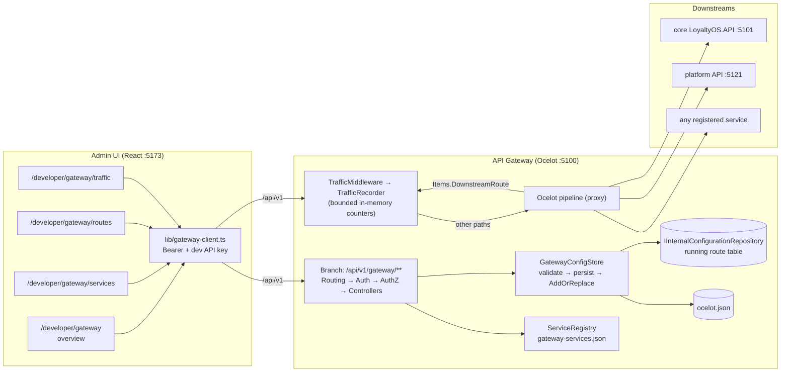
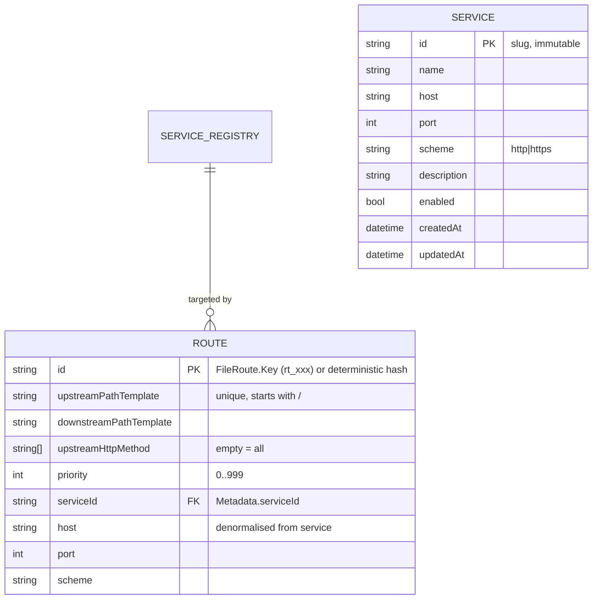

# Ocelot Gateway Management (Admin UI → Developer menu) — Requirement & Architecture

> Audience: Product Manager → Senior Architect → Senior Developer.
> Stack: Ocelot 25 gateway (`apps/api-gateway`, .NET 10, port 5100), React 18 + Vite admin (`apps/admin`).
> Rule: simple, specific, implementable. No new microservices, no new database. Unknowns are under **Open Questions**.
> Deliverable: this requirement **and** its implementation (Admin UI pages + gateway admin API).
>
> NOTE (2026-10-07, multiple_tenant.md §29): the 4 gateway UI pages moved from
> `apps/admin` to the new platform backoffice `apps/admin-platform` (dev port
> 5174, same `lib/gateway-client.ts`). Routing/API below is unchanged.

---

# PHASE 1 — PRODUCT REQUIREMENT

## 1. Business Problem

The gateway is the single entry point in front of the two downstream .NET services (core `:5101`,
platform `:5121`). Its routing table lives in one static file, `apps/api-gateway/ocelot.json`, that is
read **once at startup** and never reloaded.

Consequences today:

1. **Adding a downstream service or route is a code change.** Edit JSON by hand → restart the gateway →
   discover at runtime that the template was wrong. No UI, no validation feedback, no audit.
2. **Nobody can answer "how many services do we have behind the gateway?"** The answer is implicit in
   a list of `DownstreamHostAndPorts` blocks scattered over 6 routes.
3. **No traffic visibility.** When a path 404s or a downstream is slow, there is no view of what the
   gateway actually proxied, to which route, with which status codes.
4. **Config mistakes are cheap to make and expensive to find.** A mistyped `UpstreamPathTemplate`
   silently changes which service answers; there is no validate-before-apply step.

## 2. Business Justification

- **Speed of change:** platform engineers add/adjust routes in seconds instead of edit-restart cycles.
- **Safety:** every change is validated (Ocelot's own `FileConfigurationFluentValidator` + our rules)
  **before** it touches the file or the running routing table. A rejected change leaves the gateway
  exactly as it was.
- **Operability:** the gateway is the right place to see topology (services, routes) and traffic
  (volume, errors, latency) because every request already passes through it.
- **Debuggability:** "which service owns `/api/v1/points/*`?" becomes a 5-second lookup instead of a
  grep through JSON.

Who benefits: platform/DevOps engineers (change loop), on-call engineers (traffic + topology during
incidents), developers (route debugging). End customers and POS are not affected — the proxying
behaviour of existing routes does not change.

## 3. Scope

### In scope (v1)

1. **Gateway overview page** — status, **number of services**, number of routes, last applied config,
   traffic snapshot, links to the other pages.
2. **Services page** — list downstream services (**with the total count**), add a service, edit a
   service, delete a service, optional reachability check.
3. **Routing page** — list/inspect routes, create a route, edit a route, delete a route; every change
   is validated and applied **hot (no restart)**.
4. **Traffic page** — live monitoring: total requests, requests/sec, status-class split, per-route and
   per-service counters, latency, one-hour timeline.
5. **Gateway-local admin API** under `/api/v1/gateway/**` that implements all of the above.
6. **Service registry** persisted next to `ocelot.json` (`gateway-services.json`), seeded from the
   existing routes on first access.
7. Authorisation (platform JWT) + audit logging of every configuration change.

### Out of scope (v1)

- Service discovery (Consul / Eureka / Kubernetes), load-balancer configuration UI.
- TLS certificates, upstream auth, header/claim manipulation, QoS, rate limiting, caching as editable
  route fields (they stay supported by Ocelot and can be pasted in the raw JSON view later).
- Multi-instance gateway configuration sync (v1 assumes **one** gateway instance).
- Persistent traffic history / analytics / alerting (in-memory, process-lifetime only).
- Config versioning history, one-click rollback, diff view (follow-up).
- Editing `GlobalConfiguration` (BaseUrl, CORS, QoS defaults) from the UI.

## 4. Actors & Roles

| Actor | Scope | Can | Cannot |
|---|---|---|---|
| **Platform Super Admin** (`SUPER_ADMIN` JWT) | Global | All gateway pages, all reads and writes | — |
| **Tenant admin** (tenant JWT) | Tenant | Nothing on these pages (v1) | Read or change gateway topology |
| **Developer (local)** | Dev machine | Everything on the pages via the dev API key when the gateway runs in `Development` | Use the dev key against a `Production` gateway |
| **Anonymous / public** | — | Nothing | Reach `/api/v1/gateway/**` at all |
| End customer / POS / app | — | Unchanged behaviour | — |

## 5. Business Requirements

| ID | Requirement |
|---|---|
| BR-1 | The Developer menu must show a **Gateway** entry with sub-pages: Overview, Services, Routing, Traffic. |
| BR-2 | The overview must **display the number of registered services** and the number of routes, refreshed from the gateway. |
| BR-3 | A user may **add a service** (name, host, port, scheme, description) and later edit or delete it. |
| BR-4 | A user may **configure service routing**: create/edit/delete an Ocelot route that binds an upstream path template (+ methods, priority) to a **registered service**. |
| BR-5 | Every configuration change is **validated before it is applied**; an invalid change never modifies the running gateway. |
| BR-6 | Valid changes take effect **immediately, without restarting the gateway** (hot reload). |
| BR-7 | Every change is **persisted** so it survives a gateway restart. |
| BR-8 | The Traffic page **monitors traffic through the gateway**: volume, error rate, per-route/service breakdown, timeline; it auto-refreshes. |
| BR-9 | Every configuration change is **audited** (who, what, when) in the gateway log. |
| BR-10 | Reads and writes require authorisation; writes require `SUPER_ADMIN` outside `Development`. |

## 6. System Requirements

| ID | Requirement |
|---|---|
| SR-1 | The gateway serves its own admin API at `api/v1/gateway/**`, handled **before** Ocelot proxying (reserved prefix, never proxied downstream). |
| SR-2 | `GatewayConfigStore` is the single writer of `ocelot.json`: read → mutate → validate → persist → hot-apply, serialised by a semaphore (one change at a time). |
| SR-3 | Hot apply = build `IInternalConfiguration` with Ocelot's `IInternalConfigurationCreator` and `AddOrReplace` it in `IInternalConfigurationRepository` (public Ocelot APIs). |
| SR-4 | Service registry is stored in `gateway-services.json` in the gateway ContentRoot; if absent it is **seeded** from the current routes (deduplicated by `scheme://host:port`). |
| SR-5 | Traffic is recorded by a middleware that runs around the whole pipeline, keyed by **route template** (never by raw URL) and held in **bounded** in-memory structures. |
| SR-6 | `GET /api/v1/gateway/summary` returns `serviceCount`, `routeCount`, config timestamps and flags when `ocelot.json` was modified **outside** the API (manual edit detection). |
| SR-7 | `POST /api/v1/gateway/config/reload` re-reads `ocelot.json`, validates and applies it, so manual edits can be picked up without a restart. |
| SR-8 | Admin UI: 4 pages, 4 routes, sidebar entries, i18n keys (`en-US`, `es-MX`), one small API client helper. |
| SR-9 | Existing routes and their behaviour must be **byte-for-byte semantically unchanged** by a no-op round-trip of the config API. |

## 7. Business Rules

| ID | Rule |
|---|---|
| BR-R1 | Service `id` is unique, derived from the name (`slug`), immutable once created; host must be a non-empty hostname/IP, port `1..65535`, scheme ∈ {`http`,`https`}. |
| BR-R2 | A service that is referenced by at least one route **cannot be deleted** (HTTP 409 listing the routes). |
| BR-R3 | `UpstreamPathTemplate` must start with `/`, must be unique (case-insensitive) across active routes, and **must not** start with the reserved admin prefix `/api/v1/gateway`. |
| BR-R4 | Empty `UpstreamHttpMethod` means *all methods* (Ocelot semantics) and is allowed; otherwise methods must be a subset of GET/POST/PUT/PATCH/DELETE/HEAD/OPTIONS. |
| BR-R5 | `Priority` is `0..999`; higher wins. The UI explains that `0` = catch-all and warns when a new route could shadow existing ones. |
| BR-R6 | A configuration is applied **atomically**: validate → write file → replace in-memory config. If any step fails, nothing changes (running config and file both keep the previous state). |
| BR-R7 | Deleting the last remaining route is rejected unless `force=true` (the UI shows an explicit destructive confirmation), because it would take the whole gateway to 404. |
| BR-R8 | Route identity: Ocelot `Key` when present, otherwise a deterministic id derived from upstream template + methods. Routes created by the UI always get `Key = rt_<8 hex>`. |
| BR-R9 | Traffic counters are keyed by route template and reset when the process restarts; they never store raw paths, query strings, headers, bodies, or any PII. |
| BR-R10 | In `Development` only, the admin API also accepts `X-API-Key` (configured `Gateway:DevApiKey`, default `dev-key`); in any other environment that key is rejected. |

## 8. Workflow

**Add a service + route (hot):**

1. Developer opens *Developer → Gateway → Services → Add service*, fills name/host/port/scheme → `POST`.
2. Registry file is updated; the page shows `N+1 services`.
3. Developer opens *Routing → New route*, picks the service, enters upstream/downstream templates and methods.
4. Gateway validates the candidate config; on success it writes `ocelot.json` and replaces the running route table.
5. The next proxied request already uses the new route — **no restart**.

**Monitor traffic:** open *Traffic* → counts update every 5 s (react-query `refetchInterval`); the table
shows per-route volume, error rate and average/max latency; the chart shows the last 60 minutes.

**Recover from a bad manual edit:** the overview flags "ocelot.json changed outside the API"; the user
presses **Reload config** → the file is validated and applied, or rejected with the errors listed.

## 9. API & Integration

All endpoints are served by the gateway itself, prefix **`/api/v1/gateway`**, JSON, envelope
`{ "data": ... }` on success and `{ "error": { "code", "message", "retryable", "details"? } }` on
failure (same convention as the core API). Calls go through the normal Admin UI origin
(`/api/v1` → Vite proxy → `:5100`), so no new CORS or host is needed.

| Method | Path | Purpose | Auth |
|---|---|---|---|
| GET | `/summary` | counts, status, config metadata, external-edit flag | read |
| GET | `/services?health=true` | list + **service count** (+ optional TCP reachability) | read |
| POST | `/services` | add service | write |
| PUT | `/services/{id}` | edit service | write |
| DELETE | `/services/{id}` | delete (409 if referenced) | write |
| GET | `/routes` | list routes (id, templates, methods, priority, service, health refs) | read |
| POST | `/routes` | create route | write |
| PUT | `/routes/{id}` | edit route | write |
| DELETE | `/routes/{id}?force=` | delete route | write |
| POST | `/config/reload` | re-read + validate + apply `ocelot.json` | write |
| GET | `/traffic?windowMinutes=` | traffic snapshot | read |
| POST | `/traffic/reset` | clear counters (dev convenience) | write |

Representative payloads:

```jsonc
// GET /summary → 200
{ "data": {
    "serviceName": "LoyaltyOS gateway", "environment": "Development", "version": "1.0.0",
    "baseUrl": "http://localhost:5100", "startedAt": "2026-10-05T09:12:00Z", "uptimeSeconds": 4210,
    "serviceCount": 2, "routeCount": 6, "registryRouteLinks": 6,
    "config": { "revision": 3, "appliedAt": "...", "appliedBy": "ops@x.com", "source": "api|file|startup" },
    "externalFileModified": false
} }

// POST /routes → 201  (400 with details[] when validation fails — nothing is applied)
// NOTE: host/port/scheme are NOT part of the request — they are copied from the
// registered service. The implemented RouteUpsertRequest is:
// { upstreamPathTemplate, downstreamPathTemplate, upstreamHttpMethod[], priority,
//   serviceId, upstreamHost? }
{ "data": { "id": "rt_9f2c11ab", "upstreamPathTemplate": "/api/v1/loyalty/{all}",
            "downstreamPathTemplate": "/api/v1/{all}", "upstreamHttpMethod": ["GET"],
            "downstreamScheme": "http", "host": "localhost", "port": 5101, "priority": 1,
            "serviceId": "core" } }

// GET /traffic → 200
// NOTE: the implemented TrafficSnapshot has no `perSecond` and uses
// count2xx/count4xx/count5xx (not errors2xx/…); per-second is derived
// client-side as total/uptimeSeconds from GET /summary.
{ "data": {
    "windowMinutes": 60, "total": 18234,
    "byStatusClass": { "2xx": 18001, "4xx": 210, "5xx": 23 },
    "series": [ { "minute": "09:12", "count": 120, "errors": 2 } ],
    "routes": [ { "key": "rt_9f2c11ab", "upstream": "/api/v1/loyalty/{all}", "serviceId": "core",
                  "serviceName": "core", "count": 5120, "count2xx": 5100, "count4xx": 18,
                  "count5xx": 2, "avgMs": 34, "maxMs": 812, "lastSeen": "..." } ],
    "services": [ { "serviceId": "core", "serviceName": "core", "count": 5120,
                    "count2xx": 5100, "count4xx": 18, "count5xx": 2, "avgMs": 34, "maxMs": 812 } ]
} }
```

Integration notes: **no** change to core (`:5101`) or platform (`:5121`) APIs; the gateway admin API is
new and additive. The reserved prefix `/api/v1/gateway` currently reaches the catch-all route and
404s at the core API, so reserving it breaks no existing consumer.

## 10. Data Requirements

| Store | Location | Lifetime | Contents |
|---|---|---|---|
| Route table | `apps/api-gateway/ocelot.json` (ContentRoot) | Persistent (file) | Ocelot `FileConfiguration`: `Routes[]`, `GlobalConfiguration` — **existing file, same schema** |
| Service registry | `apps/api-gateway/gateway-services.json` (ContentRoot, new) | Persistent (file) | `{ "services": [ { id, name, host, port, scheme, description, enabled, createdAt, updatedAt } ] }` |
| Running config | `IInternalConfigurationRepository` | Process | Validated config actually used for routing |
| Traffic counters | `TrafficRecorder` singleton | Process, bounded | 60 × 1-minute buckets + per-route counters |
| Audit | Gateway structured log (`ILogger`) | Log retention | One line per mutation: actor, action, target, revision, result |

No database is added. `ocelot.json` is written with Newtonsoft `Formatting.Indented` and must round-trip
**semantically unchanged** (SR-9) — verified by a round-trip test.

## 11. Non-Functional Requirements

- **Latency:** traffic middleware adds < 1 ms per request (in-memory increments, no I/O, no locks on
  the hot path beyond a per-bucket `Interlocked`/single-writer rotation).
- **Memory:** traffic storage bounded — 60 buckets, per-route counters capped (500 keys, oldest pruned).
- **Apply latency:** validate + persist + swap < 200 ms for ≤ 200 routes. **Proposed Target — Requires Confirmation.**
- **Availability:** the admin API must never break proxying. If it fails, `/api/v1/gateway/**` returns
  5xx while all other traffic keeps flowing.
- **Scalability:** single gateway instance assumed (see Risks).
- **Security:** JWT bearer with the shared `Jwt:SecretKey`; writes require `role=SUPER_ADMIN` unless the
  gateway environment is `Development`; no anonymous access; no PII in metrics.
- **Compatibility:** Ocelot stays at 25.0.1; all configuration is applied through Ocelot's public APIs.

## 12. Error Handling

| Case | Status | Body |
|---|---|---|
| Validation failed (Ocelot or our rules) | 400 | `error.code=CONFIG_INVALID`, `details[]` = Ocelot error messages, `retryable=false`, **nothing applied** |
| Missing/invalid token, or write without `SUPER_ADMIN` | 401 / 403 | `UNAUTHORIZED` / `FORBIDDEN` |
| Unknown service or route id | 404 | `NOT_FOUND` |
| Service still referenced by routes; duplicate upstream template; route id mismatch | 409 | `SERVICE_IN_USE` / `ROUTE_EXISTS` / `REVISION_CONFLICT` |
| Cannot write `ocelot.json` (permissions / read-only FS) | 503 | `CONFIG_PERSIST_FAILED`, `retryable=true`, running config unchanged |
| Gateway internal failure | 500 | `INTERNAL_ERROR`, `retryable=true` |
| Client error body (bad JSON, wrong types) | 400 | `BAD_REQUEST` |

The Admin UI renders `error.message` + `details[]`, keeps the form open on failure, and never reports
success before the gateway confirms the apply.

## 13. Edge Cases

1. **Two admins edit at the same time** — writes are serialised inside the gateway; last write wins and
   the UI refreshes revision after each mutation. (Optimistic concurrency is a follow-up.)
2. **Apply while requests are in flight** — in-flight requests keep the immutable old config object;
   the next request sees the new one. No request is dropped.
3. **Invalid config submitted** — rejected with `details[]`; file and running config unchanged.
4. **File system is read-only / no permission** — apply fails after validation; running config is **not**
   swapped; 503 returned; UI shows the message. (In-memory-only mode is out of scope.)
5. **Deleting a service that routes point at** — 409 with the list of blocking routes.
6. **`ocelot.json` edited by hand while running** — `externalFileModified=true` on the overview; user can
   `POST /config/reload` to validate + apply, or ignore it (restart applies the file anyway).
7. **Duplicate upstream template** (also created by hand) — creation/update rejected with 409.
8. **Downstream service is down** — health check returns `unknown`/`down` after a 1 s TCP timeout; the
   page never blocks on it (health is opt-in and rendered per row).
9. **Request matches no route** — Ocelot returns 404; traffic records it under `(unmatched)`.
10. **Gateway restart** — config and services reload from disk; traffic counters start from zero and the
    UI shows "since restart".
11. **Scaling to two gateway instances** — each instance keeps its own file and counters; changes do not
    replicate (documented limitation, v1 single instance).
12. **A route is deleted while its traffic row is displayed** — counters are kept and labelled
    "(removed route)" until the process restarts.
13. **Placeholder mismatch** (`{all}` upstream but not downstream) — Ocelot validator rejects the apply.
14. **Attempt to shadow the admin API** — routes whose upstream starts with `/api/v1/gateway` are
    rejected (BR-R3); the admin branch runs before Ocelot regardless.
15. **Deleting the last route** — rejected without `force=true` (BR-R7).
16. **Corrupt `gateway-services.json`** — startup/read returns a clear 500 with the parse error; the
    registry is never silently rewritten from scratch (avoids losing hand edits).
17. **Concurrent traffic while config changes** — recorder is independent of routing; unknown route keys
    are simply kept as historical rows.
18. **Huge traffic volume** — counters are `long`; memory stays bounded by the caps, never by QPS.

## 14. Acceptance Criteria

- **AC-1 (service count).** *Given* the gateway is running with the current `ocelot.json`, *when* a
  platform admin opens *Developer → Gateway*, *then* the overview shows `Services: 2` (core, platform)
  and `Routes: 6`, and the value matches `GET /api/v1/gateway/summary`.
- **AC-2 (add service).** *Given* the Services page, *when* the user creates service
  `reporting → http://localhost:5130`, *then* the list shows 3 services, the registry file contains the
  entry, and no gateway restart occurred.
- **AC-3 (hot routing).** *Given* a registered service `reporting`, *when* the user creates route
  `/api/v1/reporting/{all}` → that service and sends `GET /api/v1/reporting/ping`, *then* the request is
  proxied to `localhost:5130` **without restarting** the gateway.
- **AC-4 (validation).** *Given* the Routing page, *when* the user submits an upstream template that does
  not start with `/` or duplicates an existing one, *then* the API returns 400/409 with details, the UI
  shows them, the file is unchanged and traffic continues on the old table.
- **AC-5 (delete guard).** *When* the user deletes a service referenced by a route, *then* 409 is
  returned and neither the registry nor the route table changes.
- **AC-6 (traffic).** *Given* requests have been proxied, *when* the user opens the Traffic page, *then*
  total/`perSecond`/status-class counters and the per-route rows are non-zero, refresh at ≤ 5 s, and reset
  only on `POST /traffic/reset` or gateway restart.
- **AC-7 (authorisation).** *When* a request to any `/api/v1/gateway/**` write endpoint arrives in
  `Production` without a `SUPER_ADMIN` bearer token, *then* 401/403 is returned and nothing changes; in
  `Development` the dev API key is accepted.
- **AC-8 (persistence).** *Given* a route was created through the UI, *when* the gateway is restarted,
  *then* the route is present and working, and `git diff` on `ocelot.json` shows only the intended change.
- **AC-9 (round-trip).** *When* no change is made and the config is read and re-applied, *then* the
  resulting `ocelot.json` is semantically identical to the original (SR-9).
- **AC-10 (manual edit).** *Given* `ocelot.json` is edited outside the UI while running, *when* the
  overview is loaded, *then* `externalFileModified` is shown, and pressing *Reload config* either applies
  the file without a restart or lists the validation errors.
- **AC-11 (regression).** *When* all of the above is deployed, *then* the existing pages and APIs
  (dashboard, members, idempotency, platform tenants) behave exactly as before through the gateway.

## 15. Existing System Impact

| Area | Change | Risk |
|---|---|---|
| `apps/api-gateway/Program.cs` | Add auth + CORS/routing branch before `UseOcelot()`, traffic middleware | Pipeline ordering must be verified (see Risks) |
| `apps/api-gateway/ocelot.json` | Same schema; rewritten on change with 2-space indent | Round-trip must be semantically neutral (AC-9) |
| `apps/api-gateway/gateway-services.json` | New file | None |
| `apps/admin` | 4 new pages, routes, sidebar children, i18n keys, `lib/gateway-client.ts` | Additive |
| `apps/api-dotnet` (core, platform) | **No changes** | None |
| Ocelot package | No upgrade (25.0.1) | None |

## 16. Backward Compatibility

- Existing `ocelot.json` routes, priorities and downstreams are untouched by the initial seeding step.
- The admin API is served on a **new reserved prefix** `/api/v1/gateway` that today ends in a core-API
  404; no existing consumer can be affected.
- The Admin UI keeps working without a platform session in dev (dev API key), exactly like the existing
  Idempotency tool.

## 17. Security & Privacy

- **Authentication:** `Microsoft.AspNetCore.Authentication.JwtBearer` in the gateway, validating the
  same `Jwt:SecretKey` / `Jwt:Issuer` / `Jwt:Audience` the platform API uses to mint admin tokens.
- **Authorisation:** two policies — `GatewayViewer` (valid admin token, or dev key in `Development`) for
  reads, `GatewayAdmin` (`role=SUPER_ADMIN`, or dev key in `Development`) for writes.
- **Reserved prefix** is answered before Ocelot, so it can never be proxied to a downstream.
- **Audit:** one structured log line per mutation with the authenticated subject (email claim) — no
  passwords/tokens are ever logged.
- **PII:** traffic metrics store route templates, status classes, counts and durations only.
- **Exposure:** internal `host:port` values become visible to whoever can call the API — acceptable
  because access is restricted to platform admins (Open Question: tenant admins?).

## 18. Monitoring & Audit

- Gateway logs: `config applied revision=3 routes=7 services=3 by=ops@x.com source=api in 42ms`,
  `config rejected revision=3 errors=[...]`, auth failures.
- The Traffic page is the operational monitor for v1; counters are also exported through `GET /traffic`
  so they can be scraped later without changing the recorder.

## 19. Risks

| Risk | Mitigation |
|---|---|
| Running `UseRouting`/`UseEndpoints` before `UseOcelot()` does not short-circuit as expected | Spike + manual test in the first implementation step; fallback is a `MapWhen` branch with its own routing (the pattern Ocelot's own acceptance tests use) |
| `ocelot.json` round-trip changes formatting/semantics | AC-9 round-trip test + `git diff` review of the initial seeding |
| Manual edits and the UI diverge | `externalFileModified` detection + `POST /config/reload` |
| Config file not persisted in a container (ContentRoot is the image layer) | v1 gateway runs via `dotnet run`; document volume-mount requirement in the gateway README |
| Dev API key accepted in `Development` | Environment-gated (SR/BR-R10); production requires JWT |
| Traffic memory growth | Hard caps + template-only keys (SR-5) |
| Two gateway instances would diverge | Documented single-instance assumption |

## 20. Assumptions

1. One gateway instance per environment.
2. The gateway process can write its ContentRoot directory.
3. The Admin UI reaches the gateway through the existing `/api/v1` origin (Vite proxy / same host).
4. `Jwt:SecretKey` is shared by platform API and gateway (it already is, by configuration convention).
5. "Services" = distinct downstream `scheme://host:port` targets, which is how Ocelot models them.

## 21. Open Questions

1. Should **tenant admins** get read-only traffic visibility? *(v1: no.)*
2. Should v1 expose advanced route options (QoS, rate limit, cache, header/claim transforms)? *(v1: no —
   minimal field set listed in §9.)*
3. Do you need HTTP health checks (URL + expected status) instead of / in addition to TCP reachability?
4. Traffic retention beyond process lifetime (e.g. Prometheus/OpenTelemetry export) needed later?
5. Is `serviceCount` expected to count **disabled** services too? *(v1: all registry entries, with an
   `enabled` flag shown.)*

## 22. Requirement Review (self-review)

Checked for ambiguity, conflicts, feasibility, security and API compatibility; issues found and fixed:

1. *Ambiguous "manage gateway"* → split into overview/status, services, routing, traffic (BR-1..BR-8).
2. *Ocelot has no Service entity* → introduced an explicit registry file + seed rule (SR-4) instead of
   pretending routes are services; routes still carry Ocelot's real host/port so proxying is unchanged.
3. *"Hot reload" could mean file polling* → defined precisely as validate + persist + `AddOrReplace`
   (SR-2/SR-3), which is atomic and instant; no poller, no restart.
4. *Missing write-safety rule* → BR-R6 (atomic apply) and BR-R7 (last-route guard).
5. *Route identity was undefined* → BR-R8 (Ocelot `Key` + deterministic fallback).
6. *Metrics could leak PII / grow unbounded* → BR-R9 + SR-5 caps.
7. *Config file could be corrupted by a partial write* → single serialised writer + validate-before-write
   (SR-2), 503 on write failure with no in-memory swap (edge case 4).
8. *Reserved prefix not documented* → §16, plus BR-R3 blocking shadow routes.
9. *Two admins racing* → edge case 1: serialised writes, revision shown in UI (optimistic concurrency
   deliberately deferred, not silently promised).
10. *Health check could hang the page* → opt-in, 1 s timeout, rendered per row (edge case 8).
11. *Restart persistence was implicit* → AC-8 makes it explicit and testable.
12. *Security of an unauthenticated control plane* → §17, AC-7, environment-gated dev key.

---

# PHASE 2 — SYSTEM DESIGN

## 1. Architecture



**Pipeline order** (`Program.cs`): `UseCors` → `TrafficMiddleware` → `UseWhen(/api/v1/gateway → UseRouting → UseAuthentication → UseAuthorization → UseEndpoints(MapControllers) → local 404)` → `UseOcelot()`.

**Options considered for hosting the admin API**

| Option | Verdict |
|---|---|
| **A. Endpoints inside the gateway, before Ocelot (chosen)** | Config file and running config live in the same process → atomic hot apply; no cross-service file sharing; natural place for traffic metrics |
| B. Endpoints in core API writing the gateway's file | Rejected: two processes, non-atomic, breaks as soon as they run in different containers |
| C. Ocelot's built-in `FileConfigurationController` | Not wired in Ocelot 25 (no `AddAdministration` in the shipped package), unauthenticated, no service registry or metrics |

**Options considered for hot apply**

| Option | Verdict |
|---|---|
| **1. `IInternalConfigurationCreator` + `IInternalConfigurationRepository.AddOrReplace` after writing the file (chosen)** | Instant, atomic, uses public Ocelot APIs, single source file |
| 2. `AddConfigurationPoller()` (≈1 s file polling) | Rejected: adds latency, extra hosted service, and still needs our own writer |
| 3. Restart on change | Rejected by decision (hot reload required) |

## 2. API Design

Controllers live in `apps/api-gateway/Gateway/`:

| File | Responsibility |
|---|---|
| `GatewayAdminController.cs` | `[ApiController] [Route("api/v1/gateway")]`, DTO binding, policy attributes |
| `GatewayConfigStore.cs` | Serialised read/mutate/validate/persist/apply of `ocelot.json` + revision bookkeeping |
| `GatewayServiceRegistry.cs` | `gateway-services.json` CRUD + seed-from-routes + referential check |
| `GatewayRouteService.cs` | Route DTO ↔ `FileRoute` mapping, id resolution, uniqueness/shape rules |
| `TrafficRecorder.cs` | Bounded counters, bucket rotation, snapshot builder |
| `TrafficMiddleware.cs` | Wraps the pipeline, attributes requests via `HttpContext.Items.DownstreamRoute()` |
| `GatewayAuth.cs` | `GatewayViewer` / `GatewayAdmin` policies + dev-key handler |
| `GatewayModels.cs` | Requests/responses |

Validation order for any route/service mutation: **our rules (BR-R1..R8) → Ocelot
`IInternalConfigurationCreator.Create` → persist → `AddOrReplace`**. Any failure aborts with the
existing error envelope and leaves both the file and the running config untouched.

## 3. Data Design



- `ocelot.json` keeps Ocelot's schema exactly; `Metadata.serviceId` (an Ocelot-native dictionary) is the
  only addition and is ignored by Ocelot itself.
- `gateway-services.json` is written atomically (temp file + `File.Move` overwrite).
- Traffic: `Dictionary<routeKey, RouteStats>` + ring of 60 `MinuteBucket`s, pruned/rotated on write.

## 4. Reliability & Failure Handling

- **Single writer:** `SemaphoreSlim(1,1)` in `GatewayConfigStore` serialises every mutation, so no
  interleaved file writes (edge case 1).
- **Atomicity:** validate → write temp → move over `ocelot.json` → `AddOrReplace`. If the write fails the
  in-memory config is not touched (503).
- **Isolation:** the admin branch handles only `/api/v1/gateway/**`; any exception there returns 5xx for
  that path while proxying continues.
- **Timeouts:** health checks 1 s; no downstream calls are made by config endpoints.
- **Restart:** config + registry are files; only traffic state is lost.
- **No retries/queues needed** — all operations are synchronous, local and short.

## 5. Admin UI Design

| Route | Page | Contents |
|---|---|---|
| `/developer/gateway` | `pages/developer/gateway/index.tsx` | Stat cards: **Services**, Routes, Requests (5 min), Error rate; config meta (revision, applied at/by, external-edit banner + *Reload*); service/route health list; links |
| `/developer/gateway/services` | `pages/developer/gateway/services.tsx` | Header **"N services"**, table (name, `host:port`, scheme, routes using it, health, updated), add/edit dialog, delete with 409 handling |
| `/developer/gateway/routes` | `pages/developer/gateway/routes.tsx` | Table (upstream → service, downstream, methods, priority, traffic), create/edit dialog with service picker + priority help, delete with `force` confirm, validation errors inline |
| `/developer/gateway/traffic` | `pages/developer/gateway/traffic.tsx` | Cards (total, req/s, 2xx/4xx/5xx), recharts bar/area timeline (60 min), per-route + per-service tables, 5 s auto-refresh, *Reset* |

Shared: `lib/gateway-client.ts` (adds `Authorization: Bearer` from the platform session **and**
`X-API-Key` for dev), sidebar children under *Developer*, i18n keys `navigation.gateway|gatewayServices|gatewayRoutes|gatewayTraffic`
in `en-US` and `es-MX`, existing shadcn `Card/Table/Dialog/Select/Badge/Skeleton` components,
`@tanstack/react-query` for fetching.

## 6. Testing

- **Unit (new `LoyaltyOS.GatewayTests` or existing unit test project):** service slug/validation,
  route rules (uniqueness, reserved prefix, methods, priority), id resolution, config store
  round-trip (AC-9) against a temp ContentRoot, traffic recorder bucketing/caps, 409 on referenced service.
- **Integration (in-process `WebApplicationFactory` for the gateway):** summary counts (AC-1), create
  route → hot apply (AC-3) with a stub downstream, validation failure leaves file unchanged (AC-4),
  authorisation matrix incl. dev key (AC-7), reload after manual edit (AC-10).
- **Manual E2E:** run gateway + core + platform + admin UI, walk AC-1..AC-6 and AC-11 in the browser.
- **Regression:** `dotnet build` + existing test suites, `pnpm --filter @loyaltyos/admin typecheck && lint && test`.

---

## Decisions already taken

1. **Deliverable:** requirement **+** implementation.
2. **Change activation:** hot reload, no restart.

## Decisions to confirm before coding

1. Authorisation: **SUPER_ADMIN for writes, any valid admin token for reads, dev API key only in
   `Development`** (tenant admins blocked entirely in v1).
2. Services are stored in a **new `gateway-services.json` registry** (seeded from existing routes),
   because Ocelot itself has no Service entity.
